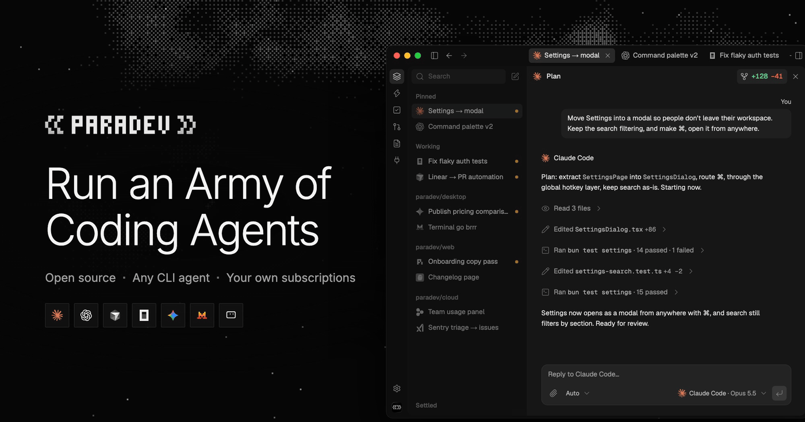
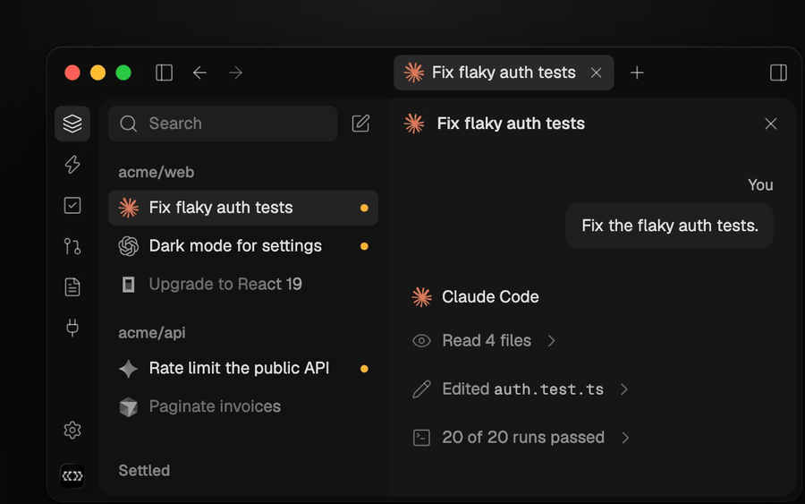
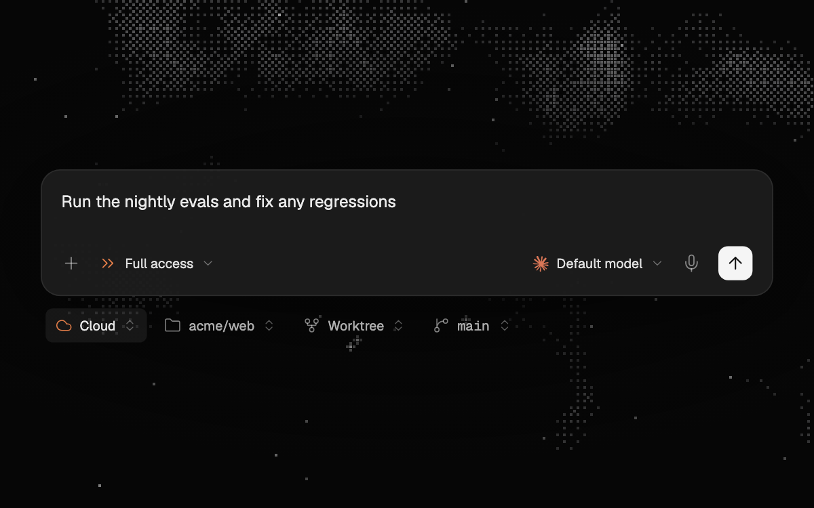
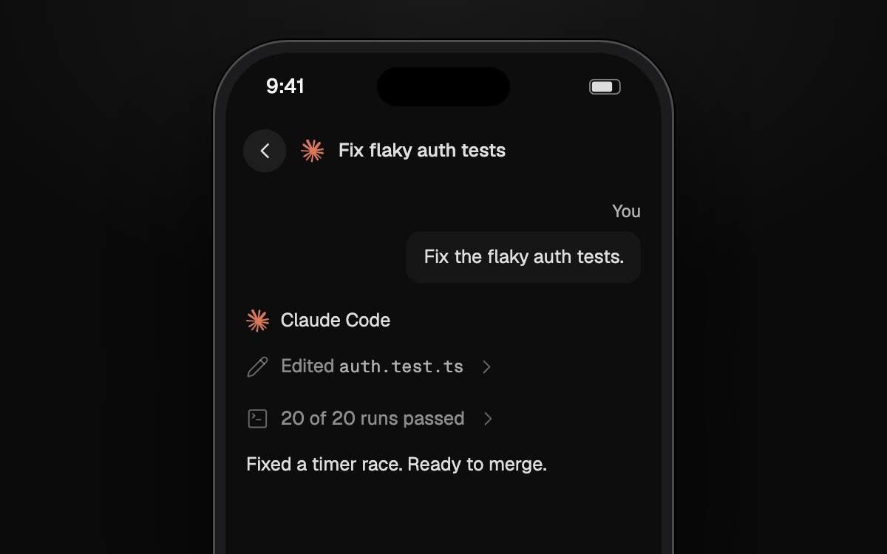

<div align="center">

<a href="https://paradev.com"></a>

### Paradev

The open-source workspace for Claude Code, Codex, and any coding agent.

[**Download for macOS**](https://github.com/paradevai/paradev/releases/latest) &nbsp;&bull;&nbsp; [Documentation](https://docs.paradev.com) &nbsp;&bull;&nbsp; [Changelog](https://paradev.com/changelog) &nbsp;&bull;&nbsp; [Discord](https://discord.gg/cZeD9WYcV7)

[](https://github.com/paradevai/paradev/stargazers)
[](LICENSE.md)

</div>

## Why Paradev

Claude Code, Codex, and OpenCode are the agents. Paradev is where you run many of them at once. You watch, review, and merge them all from one window.

- **Run agents in parallel, each on its own branch.** Each task gets its own Git worktree, branch, and terminals, so working files stay separate.
- **Use the best agent. Never get locked in.** Paradev runs Claude Code, Codex, OpenCode, Gemini CLI, Cursor Agent, and any other CLI agent. Use the agent plans and API keys you already have. Model calls go straight to your provider.

## Get started

1. **Download the app.**
   - macOS: [Apple Silicon (.dmg)](https://github.com/paradevai/paradev/releases/latest/download/Paradev-arm64.dmg) · [Intel (.dmg)](https://github.com/paradevai/paradev/releases/latest/download/Paradev-x64.dmg)
   - Linux: [x64 AppImage](https://github.com/paradevai/paradev/releases/latest/download/Superset-x86_64.AppImage) (experimental; macOS is the primary target)
   - Windows: not yet available
2. **Add a repository** from your computer, or clone one.
3. **Create a workspace**, choose your CLI agent, and describe a small change.
4. **Review the result** in **Changes**, run the tests, and preview your app in the browser pane before you commit.

You only need [Git](https://git-scm.com/) installed. [gh](https://cli.github.com/) is optional and enables the pull request workflows; Paradev offers to install it for you. For a full walkthrough, see [Your First Parallel Session](https://docs.paradev.com/first-workspace).

The `superset` CLI comes with the desktop app. You can also install it on its own:

```bash
curl -fsSL https://paradev.com/cli/install.sh | sh
# or
brew install paradevai/tap/superset
```

Paradev was previously named Superset, so the command is still `superset`. It is unrelated to Apache Superset, the business intelligence tool.

## Features

<table>
<tr>
<td width="50%" valign="middle">

### Parallel workspaces

Every agent runs in its own Git worktree and branch, keeping working files separate. Try two approaches to one problem and keep the better one. Changes can still conflict when merged, and worktrees do not sandbox processes.

[Docs →](https://docs.paradev.com/workspaces)

</td>
<td width="50%">
<a href="https://docs.paradev.com/workspaces"></a>
</td>
</tr>
<tr>
<td width="50%" valign="middle">

### Agent status

Track every agent from the sidebar. You get working indicators, a chime when an agent finishes, and a dock badge when one needs your attention.

[Docs →](https://docs.paradev.com/agent-integration)

</td>
<td width="50%">
<a href="https://docs.paradev.com/agent-integration"></a>
</td>
</tr>
<tr>
<td width="50%" valign="middle">

### Review and pull requests

Inspect, comment on, and edit agent changes in the diff viewer. Select diff lines to send feedback to an agent. Then watch the PR checks and merge without leaving the app.

[Diff viewer →](https://docs.paradev.com/diff-viewer) · [Pull requests →](https://docs.paradev.com/pull-requests)

</td>
<td width="50%">
<a href="https://docs.paradev.com/diff-viewer"></a>
</td>
</tr>
<tr>
<td width="50%" valign="middle">

### In-app browser

Preview your dev server next to your terminals, on the ports Paradev detects for each workspace. Turn on Design, click the part of the page you want to change, and describe the change to an agent. Your agent can click through the page and check its own work.

[Docs →](https://docs.paradev.com/browser)

</td>
<td width="50%">
<a href="https://docs.paradev.com/browser"></a>
</td>
</tr>
<tr>
<td width="50%" valign="middle">

### Automations

Run agents on a schedule or when something happens: a review request, a Slack message, a Linear issue, a Sentry issue, or a webhook. Each run opens a workspace you can review and continue. Automations need the Pro plan.

[Docs →](https://docs.paradev.com/automations)

</td>
<td width="50%">
<a href="https://docs.paradev.com/automations"></a>
</td>
</tr>
<tr>
<td width="50%" valign="middle">

### Cloud workspaces

Each workspace gets its own cloud machine and keeps working when your laptop is closed. Check in from desktop, iPhone, or iPad. Cloud workspaces are included with Team and Ultra.

[Docs →](https://docs.paradev.com/cloud-workspaces) · [Learn more →](https://paradev.com/cloud)

</td>
<td width="50%">
<a href="https://paradev.com/cloud"></a>
</td>
</tr>
<tr>
<td width="50%" valign="middle">

### iPhone and iPad

Start agents, follow them live, and review the diff from your iPhone or iPad. You can also merge the pull request there. The app requires iOS 26 or iPadOS 26 or later and is included with Paradev Pro.

[App Store →](https://apps.apple.com/us/app/id6788926383) · [Learn more →](https://paradev.com/mobile)

</td>
<td width="50%">
<a href="https://paradev.com/mobile"></a>
</td>
</tr>
<tr>
<td width="50%" valign="middle">

### CLI, SDK, and MCP server

Drive the entire app and cloud from the CLI, the SDK, or over MCP. Create workspaces, start agents, and read their terminals from a shell, a TypeScript program, or another agent.

[CLI →](https://docs.paradev.com/cli/getting-started) · [SDK →](https://docs.paradev.com/sdk/getting-started) · [MCP →](https://docs.paradev.com/mcp-server)

</td>
<td width="50%">
<a href="https://docs.paradev.com/cli/getting-started"></a>
</td>
</tr>
</table>

More in the docs: [remote access](https://docs.paradev.com/remote-access) (Pro plan) · [Pages](https://docs.paradev.com/pages) · [plugins](https://docs.paradev.com/plugins/overview) · [terminal](https://docs.paradev.com/terminal-integration) · [terminal scripts](https://docs.paradev.com/terminal-scripts) · [setup scripts](https://docs.paradev.com/setup-teardown-scripts) · [skills](https://docs.paradev.com/skills) · [Linear](https://docs.paradev.com/use-with-linear) and [Slack](https://docs.paradev.com/use-with-slack) (Pro plan) · [open in your IDE](https://docs.paradev.com/use-with-ide) · [model providers](https://docs.paradev.com/providers) · [themes](https://docs.paradev.com/custom-themes) · [shortcuts](https://docs.paradev.com/keyboard-shortcuts) · compare with [Cursor](https://paradev.com/compare/cursor-alternative), the [Codex app](https://paradev.com/compare/codex-app-alternative), and [Conductor](https://paradev.com/compare/conductor-alternative)

## Supported agents

Use the agent plans and API keys you already have. These agents are built in, and you can add any other CLI agent with its own icon. Integration depth varies: some agents report status, resume after a restart, and appear on the Usage page. See [supported agents](https://docs.paradev.com/supported-agents) for the full table.

&nbsp;[Amp Code](https://ampcode.com/) &nbsp;·&nbsp; &nbsp;[Antigravity CLI](https://antigravity.google/) &nbsp;·&nbsp; &nbsp;[Claude Code](https://github.com/anthropics/claude-code) &nbsp;·&nbsp; <picture><source media="(prefers-color-scheme: dark)" srcset="packages/ui/src/assets/icons/preset-icons/codex-white.svg" /></picture>&nbsp;[OpenAI Codex CLI](https://github.com/openai/codex) &nbsp;·&nbsp; &nbsp;[Cursor Agent](https://docs.cursor.com/agent) &nbsp;·&nbsp; <picture><source media="(prefers-color-scheme: dark)" srcset="packages/ui/src/assets/icons/preset-icons/droid-white.svg" /></picture>&nbsp;[Droid](https://www.factory.ai/) &nbsp;·&nbsp; <picture><source media="(prefers-color-scheme: dark)" srcset="packages/ui/src/assets/icons/preset-icons/fx-white.svg" /></picture>&nbsp;[fx](https://fx.sh/) &nbsp;·&nbsp; &nbsp;[Gemini CLI](https://github.com/google-gemini/gemini-cli) &nbsp;·&nbsp; <picture><source media="(prefers-color-scheme: dark)" srcset="packages/ui/src/assets/icons/preset-icons/copilot-white.svg" /></picture>&nbsp;[GitHub Copilot](https://github.com/features/copilot) &nbsp;·&nbsp; <picture><source media="(prefers-color-scheme: dark)" srcset="packages/ui/src/assets/icons/preset-icons/grok-white.svg" /></picture>&nbsp;[Grok](https://x.ai/) &nbsp;·&nbsp; <picture><source media="(prefers-color-scheme: dark)" srcset="packages/ui/src/assets/icons/preset-icons/hermes-white.svg" /></picture>&nbsp;[Hermes](https://github.com/NousResearch/hermes-agent) &nbsp;·&nbsp; <picture><source media="(prefers-color-scheme: dark)" srcset="packages/ui/src/assets/icons/preset-icons/muse-white.svg" /></picture>&nbsp;[Muse Code](https://developer.meta.com/ai/products/muse-code/) &nbsp;·&nbsp; <picture><source media="(prefers-color-scheme: dark)" srcset="packages/ui/src/assets/icons/preset-icons/devin-white.svg" /></picture>&nbsp;[Devin](https://devin.ai/cli) &nbsp;·&nbsp; <picture><source media="(prefers-color-scheme: dark)" srcset="packages/ui/src/assets/icons/preset-icons/kimi-white.svg" /></picture>&nbsp;[Kimi Code](https://www.kimi.com/) &nbsp;·&nbsp; &nbsp;[Kiro](https://kiro.dev/cli/) &nbsp;·&nbsp; <picture><source media="(prefers-color-scheme: dark)" srcset="packages/ui/src/assets/icons/preset-icons/mastracode-white.svg" /></picture>&nbsp;[Mastra Code](https://mastra.ai/) &nbsp;·&nbsp; &nbsp;[Mistral Vibe](https://mistral.ai/) &nbsp;·&nbsp; <picture><source media="(prefers-color-scheme: dark)" srcset="packages/ui/src/assets/icons/preset-icons/pi-white.svg" /></picture>&nbsp;[Oh My Pi](https://github.com/can1357/oh-my-pi) &nbsp;·&nbsp; <picture><source media="(prefers-color-scheme: dark)" srcset="packages/ui/src/assets/icons/preset-icons/opencode-white.svg" /></picture>&nbsp;[OpenCode](https://github.com/opencode-ai/opencode) &nbsp;·&nbsp; <picture><source media="(prefers-color-scheme: dark)" srcset="packages/ui/src/assets/icons/preset-icons/pi-white.svg" /></picture>&nbsp;[Pi](https://github.com/badlogic/pi-mono/tree/main/packages/coding-agent) &nbsp;·&nbsp; <picture><source media="(prefers-color-scheme: dark)" srcset="packages/ui/src/assets/icons/preset-icons/polygraph-white.svg" /></picture>&nbsp;[Polygraph](https://trypolygraph.com/)

## Contributing

Clone the repository, add it to the installed Paradev app, and create a workspace for your change. Then run the setup script once in that workspace terminal:

```bash
./.paradev/setup.local.sh
bun run dev
```

The script starts local Postgres and Redis with Docker and seeds a dev account. You do not need third-party credentials. See [DEVELOPMENT.md](./DEVELOPMENT.md) for the prerequisites and the full guide, and [CONTRIBUTING.md](CONTRIBUTING.md) for how to open a pull request.

<a href="https://github.com/paradevai/paradev/graphs/contributors">
  
</a>

## Community

- **[Star this repo](https://github.com/paradevai/paradev)**: we ship every day, and a star lets you follow along
- **[Discord](https://discord.gg/cZeD9WYcV7)**: chat with the team and community
- **[X](https://x.com/paradevai)**: follow for updates and announcements
- **[GitHub Issues](https://github.com/paradevai/paradev/issues)**: report bugs and request features
- **[GitHub Discussions](https://github.com/paradevai/paradev/discussions)**: ask questions and share ideas
- **Docs for agents**: [a Markdown index](https://docs.paradev.com/llms.txt) or [one full-text file](https://docs.paradev.com/llms-full.txt)

[](https://x.com/avimakesrobots)
[](https://x.com/flyakiet)
[](https://x.com/saddle_paddle)

<details>
<summary>Read this in other languages</summary>
<br />

[English](README.md) | [日本語](readme/README.ja.md) | [简体中文](readme/README.zh-CN.md) | [繁體中文](readme/README.zh-TW.md) | [한국어](readme/README.ko.md) | [Français](readme/README.fr.md) | [Español](readme/README.es.md) | [Deutsch](readme/README.de.md) | [Português](readme/README.pt-BR.md) | [Italiano](readme/README.it.md) | [Русский](readme/README.ru.md) | [Türkçe](readme/README.tr.md) | [Polski](readme/README.pl.md) | [Nederlands](readme/README.nl.md) | [Bahasa Indonesia](readme/README.id.md) | [Čeština](readme/README.cs.md) | [Tiếng Việt](readme/README.vi.md)

</details>

## License and pricing

The Free plan covers local workspaces, the desktop app, and the CLI, with no credit card required. Paid plans are optional: the [Pro plan](https://paradev.com/pricing) adds remote access, automations, the iPhone and iPad app, and the Linear and Slack integrations, and the Team and Ultra plans add cloud workspaces.

Paradev is open source under the [MIT License](LICENSE.md). You can inspect, modify, and self-host it, and anyone can file issues, open pull requests, or fork it.
