<div align="center">

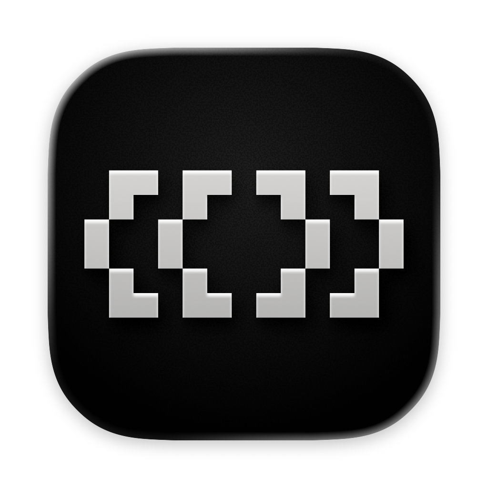

### Paradev (formerly Superset)

Run Claude Code, Codex, or another CLI agent with terminals, code review, and browser previews in one workspace.

[**Download for macOS**](https://github.com/paradevai/paradev/releases/latest) &nbsp;&bull;&nbsp; [Documentation](https://docs.paradev.com) &nbsp;&bull;&nbsp; [Changelog](https://github.com/paradevai/paradev/releases) &nbsp;&bull;&nbsp; [Discord](https://discord.gg/cZeD9WYcV7)

<p align="center">
  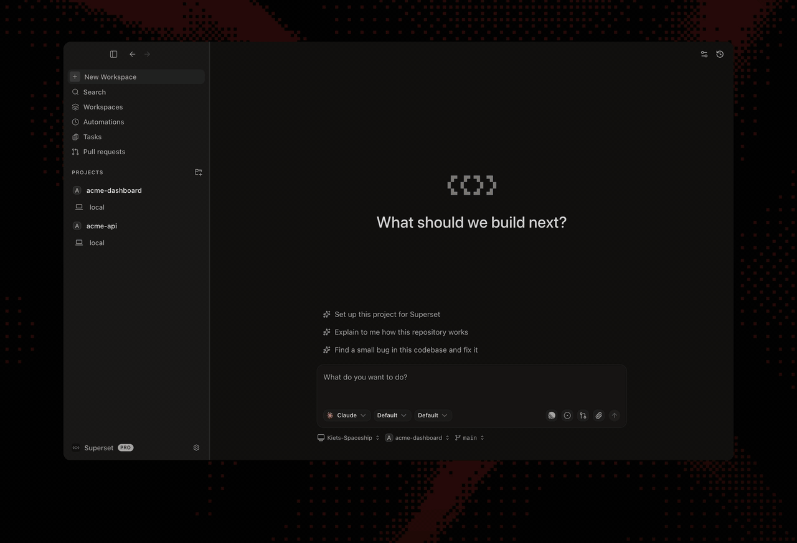
</p>

</div>

## What is Paradev?

Paradev is a desktop app for running CLI coding agents in parallel. Each task gets its own Git worktree, branch, and terminals, so Claude Code, Codex, OpenCode, Gemini CLI, Cursor Agent, or any other CLI agent can work on several tasks in one repository at the same time.

Paradev is for developers who already use a coding agent in the terminal and want to run more than one task at once, without juggling terminal tabs and branches by hand.

A single agent CLI runs one session in one terminal, and an editor is built around one checkout. Paradev adds the workspace around the agents:

- **One worktree per task**: agents work in separate copies of the repository, on separate branches
- **Review in the app**: a Changes pane to review, commit, push, and open pull requests, and a pull request pane with checks, review threads, and merge
- **In-app browser**: preview each workspace's dev server, with ports detected per workspace
- **Agent status**: the sidebar shows which agent is working, done, or waiting on you
- **Beyond one machine**: remote hosts, an iPhone and iPad app, and automations that start agents on a schedule or from an event (Pro plan)

Paradev is not a coding agent itself. You bring your own agent subscriptions and API keys, and Paradev does not proxy model calls.

**Platforms**: macOS (Apple Silicon and Intel). Linux as an experimental x64 AppImage. Windows is not yet available.

**Formerly Superset**: Paradev was previously named Superset, and the CLI command is still `superset`. It is unrelated to Apache Superset, the business intelligence tool.

**Paradev vs. alternatives**: [Cursor](https://paradev.com/compare/cursor-alternative) · [Codex app](https://paradev.com/compare/codex-app-alternative) · [Conductor](https://paradev.com/compare/conductor-alternative)

### Documentation for agents

The docs are available as [a Markdown index](https://docs.paradev.com/llms.txt) linking to individual pages, or [one full-text file](https://docs.paradev.com/llms-full.txt).

## Install

Download the desktop app:

- **macOS**: [Apple Silicon (.dmg)](https://github.com/paradevai/paradev/releases/latest/download/Superset-arm64.dmg) · [Intel (.dmg)](https://github.com/paradevai/paradev/releases/latest/download/Superset-x64.dmg)
- **Linux**: [x64 AppImage](https://github.com/paradevai/paradev/releases/latest/download/Superset-x86_64.AppImage) (experimental; macOS is the primary target)
- **Windows**: not yet available
- [All builds](https://github.com/paradevai/paradev/releases/latest)

All you need installed is [Git](https://git-scm.com/). [gh](https://cli.github.com/) is optional and enables the PR workflows; Paradev offers to install it for you.

## Start with one task

1. [Install Paradev](#install) and add a repository from your computer or clone one.
2. Create a workspace, choose your CLI agent, and describe a small change you want to make.
3. Inspect its patch in **Changes**, run the relevant tests, and preview your app in the browser pane before committing.

For a walkthrough of workspace creation and review, see [Your First Parallel Session](https://docs.paradev.com/first-workspace).

## Review and revise

- **Change your app's UI.** Use **Design** in the browser pane to select an element and send your requested change to an agent with element context. [Walkthrough](https://paradev.com/blog/change-ui-with-your-coding-agent) · [Design Mode docs](https://docs.paradev.com/browser#design-mode)
- **Ask an agent to fix a PR.** Open **Pull requests → Code**, select diff lines, and send feedback to a running or new agent session. Posting to GitHub is optional. [Walkthrough](https://paradev.com/blog/send-pr-feedback-to-your-agent) · [PR docs](https://docs.paradev.com/pull-requests#comment-straight-to-an-agent)
- **Review a report with your team.** Ask an agent to publish a Page. Teammates pin comments, and a watching agent can revise it at the same link. Keep its host and session running for feedback delivery. [Walkthrough](https://paradev.com/blog/review-agent-work-with-pages) · [Pages docs](https://docs.paradev.com/pages)

<details>
<summary>See the diff viewer and browser previews</summary>

### Built-in Diff Viewer

Inspect, comment on, and edit agent changes without leaving the app, then commit and push when it's ready.

[Docs →](https://docs.paradev.com/diff-viewer)

<a href="https://docs.paradev.com/diff-viewer">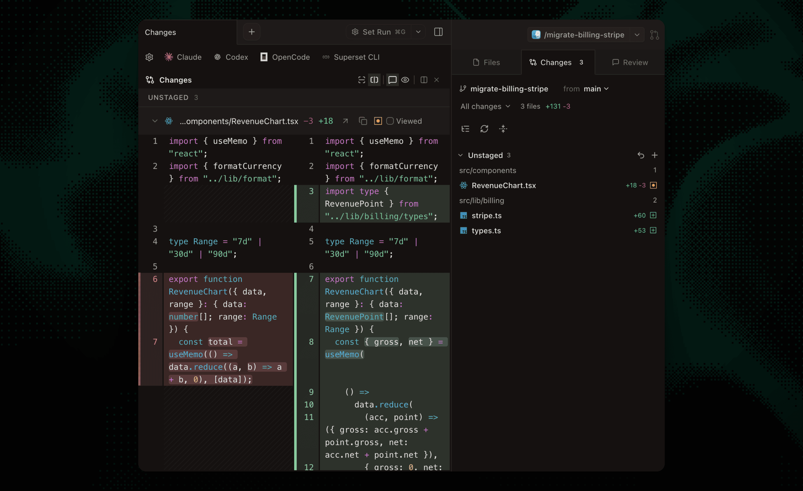</a>

### In-App Browser & Ports

Preview running dev servers in a browser pane. Ports are detected per workspace, so every worktree gets its own preview.

[Docs →](https://docs.paradev.com/browser)

<a href="https://docs.paradev.com/browser">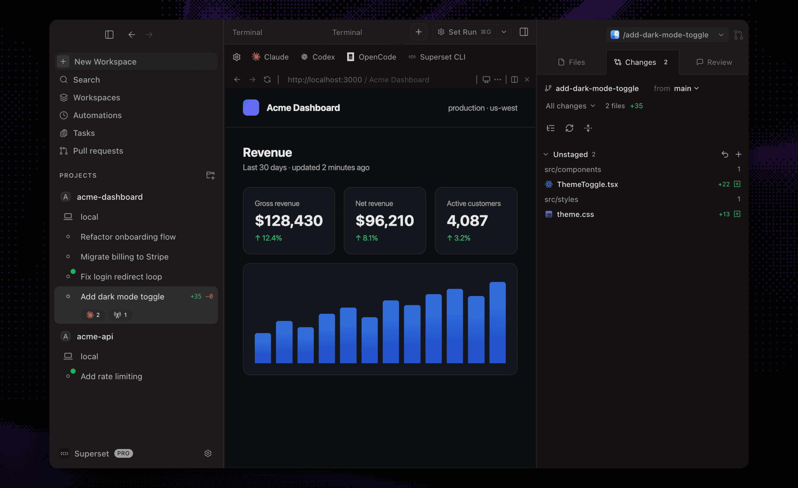</a>

</details>

## Run independent tasks

Give each task a Git worktree with its own branch and terminals. Worktrees separate working files; they do not sandbox processes or prevent merge conflicts.

[Workspace docs](https://docs.paradev.com/workspaces) · [Terminal docs](https://docs.paradev.com/terminal-integration) · [Agent status](https://docs.paradev.com/agent-integration)

<details>
<summary>See workspaces, monitoring, terminals, and the command palette</summary>

### Parallel Workspaces

Review each result before merging, or try two approaches to the same problem and keep the one you prefer.

[Docs →](https://docs.paradev.com/workspaces)

<a href="https://docs.paradev.com/workspaces">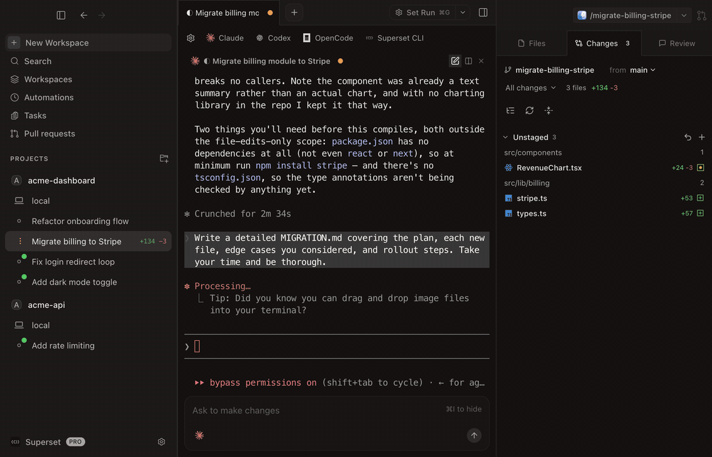</a>

### Agent Monitoring

Track every agent from the sidebar, with working indicators, completion chimes, and dock badges when one needs your attention.

[Docs →](https://docs.paradev.com/agent-integration)

<a href="https://docs.paradev.com/agent-integration">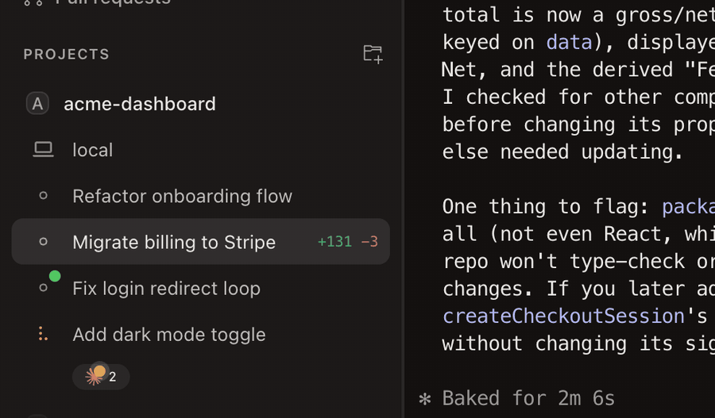</a>

### Built-in Terminal

Tabs, infinite splits, presets, and persistent sessions that survive restarts. Press ⌘I for a rich prompt editor with multiline editing and @-file mentions.

[Docs →](https://docs.paradev.com/terminal-integration)

<a href="https://docs.paradev.com/terminal-integration">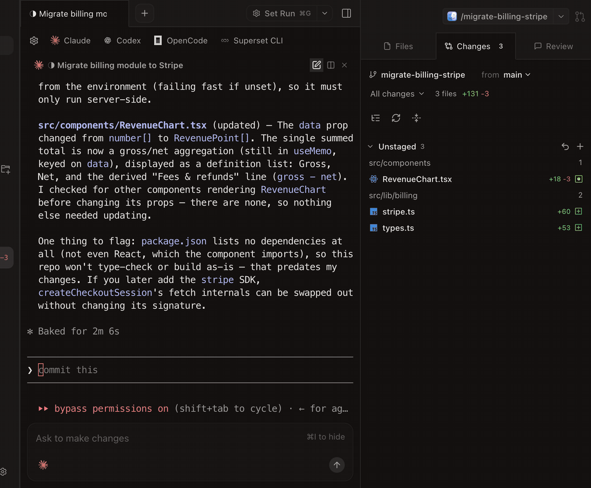</a>

### Command Palette

Jump to any workspace, action, or setting from one search box.

[Docs →](https://docs.paradev.com/keyboard-shortcuts)

<a href="https://docs.paradev.com/keyboard-shortcuts">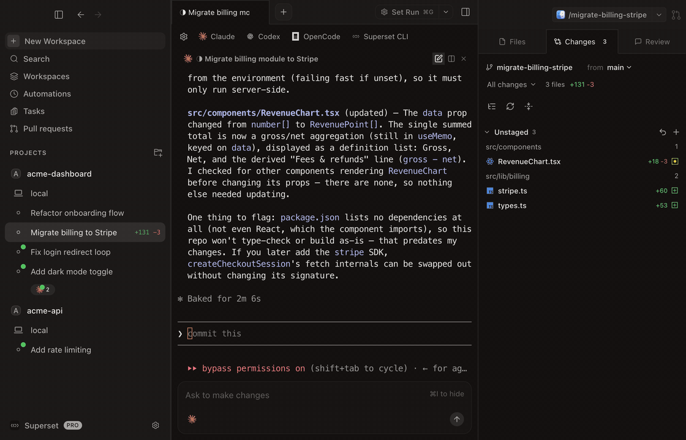</a>

</details>

## Work across devices and on a schedule

Connect another machine to reach its workspaces remotely, or schedule an agent to work on a recurring task. The CLI, SDK, and MCP server also let agents and scripts manage workspaces.

Mobile supports **iPhone and iPad** and requires **Paradev Pro** and **iOS 26 or iPadOS 26 or later**. Use cloud workspaces without keeping your own computer connected. To reach workspaces on your own computer, enable **Remote Access** and keep that host awake and online.

[Remote access](https://docs.paradev.com/remote-access) · [Automations](https://docs.paradev.com/automations) · [iPhone and iPad](https://paradev.com/mobile) · [CLI](https://docs.paradev.com/cli/getting-started)

<details>
<summary>See mobile, automations, remote access, and the CLI</summary>

### Paradev for iPhone and iPad

Control Claude Code, Codex, and other terminal agents in cloud workspaces or on your connected computer. Pick up the same workspaces and terminal sessions, send follow-up prompts, review diffs, and merge PRs from your iPhone or iPad.

[**Download on the App Store**](https://apps.apple.com/us/app/id6788926383) &nbsp;&bull;&nbsp; [Learn more →](https://paradev.com/mobile)

<a href="https://paradev.com/mobile"></a>

### Automations

Run agent sessions on a schedule or when something happens: review a PR when you're asked, triage a new Sentry issue, pick up a bug report from Slack, draft the weekly changelog.

[Docs →](https://docs.paradev.com/automations)

<a href="https://docs.paradev.com/automations">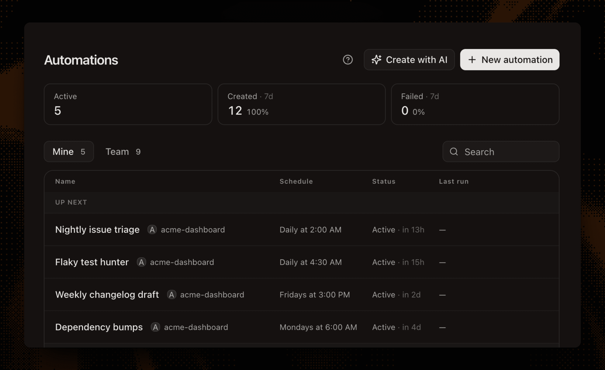</a>

### Remote Access

Connect another machine and reach its workspaces from anywhere: the desktop app, the CLI, or your phone. Wake offline hosts with a custom command.

[Docs →](https://docs.paradev.com/remote-access)

<a href="https://docs.paradev.com/remote-access">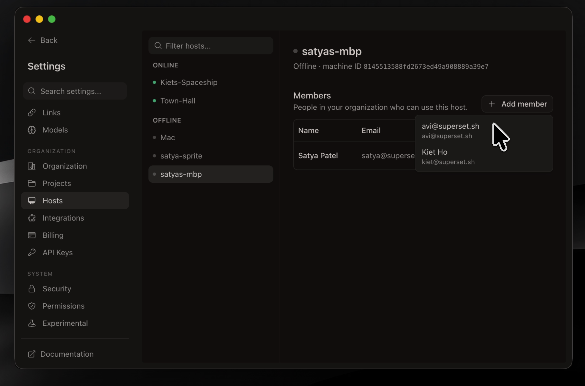</a>

### Paradev CLI

Script it from any shell: create workspaces, launch agents, read their terminals, and manage automations with a single binary. If an agent can run a command, it can drive Paradev.

[Docs →](https://docs.paradev.com/cli/getting-started)

<a href="https://docs.paradev.com/cli/getting-started">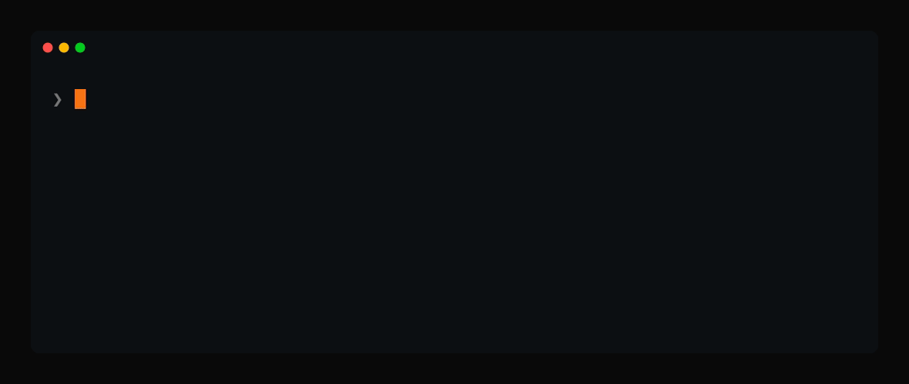</a>

</details>

## Customize your workflow

- **[Built-in skills](https://docs.paradev.com/skills)**: agents come pre-loaded with `superset:*` skills (orchestrate parallel agents, schedule automations, file feedback, diagnose issues), provisioned automatically at launch
- **[Workspace setup scripts](https://docs.paradev.com/setup-teardown-scripts)**: automate env setup, dependency installs, and dev servers per workspace
- **[Terminal presets](https://docs.paradev.com/terminal-presets)**: save agent and shell layouts and open them with one keystroke
- **[Slack & Linear](https://docs.paradev.com/use-with-linear)**: spin up workspaces from Slack messages or Linear issues
- **[Open in your IDE](https://docs.paradev.com/use-with-ide)**: one-click handoff to Cursor, VS Code, or any editor
- **[Custom themes](https://docs.paradev.com/custom-themes)**: build, edit, and import theme files
- **[Keyboard shortcuts](https://docs.paradev.com/keyboard-shortcuts)**: every action is remappable via **Settings → Keyboard Shortcuts** (⌘/)
- **[Bring your own providers](https://docs.paradev.com/providers)**: connect OpenRouter, Bedrock, Vertex, or Vercel AI Gateway
- **And many more**: we ship daily, so this list is perpetually behind. The [changelog](https://paradev.com/changelog) is the real feature list.

## Supported Agents

Keep your existing agent subscriptions.

Use Claude Code, Codex, OpenCode, Cursor Agent, or another CLI coding agent.

<details>
<summary>Browse supported agents</summary>

| Agent | Status |
|:------|:-------|
|  &nbsp;[Amp Code](https://ampcode.com/) | Fully supported |
|  &nbsp;[Antigravity CLI](https://antigravity.google/) | Fully supported |
|  &nbsp;[Claude Code](https://github.com/anthropics/claude-code) | Fully supported |
| <picture><source media="(prefers-color-scheme: dark)" srcset="packages/ui/src/assets/icons/preset-icons/codex-white.svg" /></picture> &nbsp;[OpenAI Codex CLI](https://github.com/openai/codex) | Fully supported |
|  &nbsp;[Cursor Agent](https://docs.cursor.com/agent) | Fully supported |
| <picture><source media="(prefers-color-scheme: dark)" srcset="packages/ui/src/assets/icons/preset-icons/droid-white.svg" /></picture> &nbsp;[Droid](https://www.factory.ai/) | Fully supported |
| <picture><source media="(prefers-color-scheme: dark)" srcset="packages/ui/src/assets/icons/preset-icons/fx-white.svg" /></picture> &nbsp;[fx](https://fx.sh/) | Fully supported |
|  &nbsp;[Gemini CLI](https://github.com/google-gemini/gemini-cli) | Fully supported |
| <picture><source media="(prefers-color-scheme: dark)" srcset="packages/ui/src/assets/icons/preset-icons/copilot-white.svg" /></picture> &nbsp;[GitHub Copilot](https://github.com/features/copilot) | Fully supported |
| <picture><source media="(prefers-color-scheme: dark)" srcset="packages/ui/src/assets/icons/preset-icons/grok-white.svg" /></picture> &nbsp;[Grok](https://x.ai/) | Fully supported |
| <picture><source media="(prefers-color-scheme: dark)" srcset="packages/ui/src/assets/icons/preset-icons/hermes-white.svg" /></picture> &nbsp;[Hermes](https://github.com/NousResearch/hermes-agent) | Fully supported |
| <picture><source media="(prefers-color-scheme: dark)" srcset="packages/ui/src/assets/icons/preset-icons/muse-white.svg" /></picture> &nbsp;[Muse Code](https://developer.meta.com/ai/products/muse-code/) | Fully supported |
| <picture><source media="(prefers-color-scheme: dark)" srcset="packages/ui/src/assets/icons/preset-icons/devin-white.svg" /></picture> &nbsp;[Devin](https://devin.ai/cli) | Fully supported |
| <picture><source media="(prefers-color-scheme: dark)" srcset="packages/ui/src/assets/icons/preset-icons/kimi-white.svg" /></picture> &nbsp;[Kimi Code](https://www.kimi.com/) | Fully supported |
|  &nbsp;[Kiro](https://kiro.dev/cli/) | Fully supported |
| <picture><source media="(prefers-color-scheme: dark)" srcset="packages/ui/src/assets/icons/preset-icons/mastracode-white.svg" /></picture> &nbsp;[Mastra Code](https://mastra.ai/) | Fully supported |
|  &nbsp;[Mistral Vibe](https://mistral.ai/) | Fully supported |
| <picture><source media="(prefers-color-scheme: dark)" srcset="packages/ui/src/assets/icons/preset-icons/pi-white.svg" />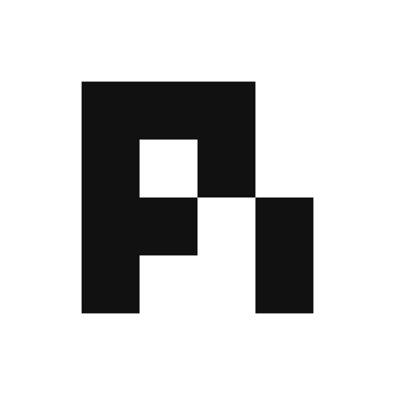</picture> &nbsp;[Oh My Pi](https://github.com/can1357/oh-my-pi) | Fully supported |
| <picture><source media="(prefers-color-scheme: dark)" srcset="packages/ui/src/assets/icons/preset-icons/opencode-white.svg" /></picture> &nbsp;[OpenCode](https://github.com/opencode-ai/opencode) | Fully supported |
| <picture><source media="(prefers-color-scheme: dark)" srcset="packages/ui/src/assets/icons/preset-icons/pi-white.svg" /></picture> &nbsp;[Pi](https://github.com/badlogic/pi-mono/tree/main/packages/coding-agent) | Fully supported |
| <picture><source media="(prefers-color-scheme: dark)" srcset="packages/ui/src/assets/icons/preset-icons/polygraph-white.svg" /></picture> &nbsp;[Polygraph](https://trypolygraph.com/) | Fully supported |
| Any other CLI agent | Works without configuration |


</details>

Agents get more than a terminal:

- **Model picker**: choose a model and reasoning effort when you launch an agent
- **Per-agent settings**: tune launch commands, prompt templates, and model overrides in Settings → Agents
- **Custom agents**: add any terminal agent with its own icon and it works like a built-in
- **Built-in chat**: talk to models in a chat pane, with inline tool approvals and plan review

## More Than a Desktop App

Every surface talks to the same workspaces, so you can start a task in the app and check on it from anywhere.

| Surface | What you get |
|:--------|:-------------|
| [**Desktop App**](https://github.com/paradevai/paradev/releases/latest) | The full IDE: terminals, diff viewer, in-app browser, automations |
| [**CLI**](https://docs.paradev.com/cli/getting-started) | A single `superset` binary to manage workspaces, agents, terminals, and hosts from any shell |
| [**TypeScript SDK**](https://docs.paradev.com/sdk/getting-started) | Drive Paradev programmatically with [`@superset_sh/sdk`](https://www.npmjs.com/package/@superset_sh/sdk) from Node, Bun, or Deno |
| [**MCP Server**](https://docs.paradev.com/mcp) | Let Claude Code, Codex, Cursor, and other agents create and manage workspaces themselves |

The CLI comes bundled with the desktop app, or install it standalone:

```bash
curl -fsSL https://paradev.com/cli/install.sh | sh
# or
brew install paradevai/tap/superset
```

## Development

Want to hack on Paradev or contribute a PR? Clone the repository, add it to the
installed Paradev app, and create a workspace for your change:

```bash
git clone https://github.com/paradevai/paradev.git
```

Then run the development setup from that workspace terminal:

```bash
./.superset/setup.local.sh
bun run dev
```

Run `setup.local.sh` once in every new worktree. It configures workspace-specific
app identity and ports so the development desktop app can run alongside the
installed Paradev app and other development worktrees.

No Neon account or third-party credentials are needed. `setup.local.sh` brings
up a local Postgres + neon-proxy + Redis stack via Docker and seeds a dev account.
Sign in with the **"Sign in as dev"** button (or `admin@local.test` / `supersetdev`).

Prereqs for building from source (to use Paradev, [install the app](#install) instead): [Bun](https://bun.sh/) v1.4.3+ (pinned in `.bun-version`), `docker`, `jq`, and [`gh`](https://cli.github.com/) (`brew install jq gh`).

See [**DEVELOPMENT.md**](./DEVELOPMENT.md) for the full guide: what the setup script does, manual setup against real services, common commands, troubleshooting, and how to build the desktop app. Contribution process lives in [**CONTRIBUTING.md**](./CONTRIBUTING.md).

## Configuration

Configure workspace setup, teardown, and run scripts in `.superset/config.json`. See [full documentation](https://docs.paradev.com/setup-teardown-scripts).

```json
{
  "setup": ["./.superset/setup.sh"],
  "teardown": ["./.superset/teardown.sh"],
  "run": ["./.superset/run.sh"]
}
```

## Tech Stack

<details>
<summary>Browse the implementation stack</summary>

<p>
  <a href="https://www.electronjs.org/"></a>
  <a href="https://reactjs.org/"></a>
  <a href="https://tailwindcss.com/"></a>
  <a href="https://bun.sh/"></a>
  <a href="https://turbo.build/"></a>
  <a href="https://vitejs.dev/"></a>
  <a href="https://biomejs.dev/"></a>
  <a href="https://orm.drizzle.team/"></a>
  <a href="https://neon.tech/"></a>
  <a href="https://trpc.io/"></a>
</p>

</details>

## Private by Default

- **Explicit Connections**: you choose which agents, providers, and integrations to connect.

## Contributing

We welcome contributions! See [CONTRIBUTING.md](CONTRIBUTING.md) for how to get set up and open a PR. Bugs and feature requests go in [issues](https://github.com/paradevai/paradev/issues).

<a href="https://github.com/paradevai/paradev/graphs/contributors">
  
</a>

[](https://github.com/paradevai/paradev/stargazers)
[](https://github.com/paradevai/paradev/releases)
[](LICENSE.md)
[](https://x.com/paradevai)
[](https://discord.gg/cZeD9WYcV7)

<details>
<summary>🌐 Read this in other languages</summary>
<br />

[English](README.md) | [日本語](readme/README.ja.md) | [简体中文](readme/README.zh-CN.md) | [繁體中文](readme/README.zh-TW.md) | [한국어](readme/README.ko.md) | [Français](readme/README.fr.md) | [Español](readme/README.es.md) | [Deutsch](readme/README.de.md) | [Português](readme/README.pt-BR.md) | [Italiano](readme/README.it.md) | [Русский](readme/README.ru.md) | [Türkçe](readme/README.tr.md) | [Polski](readme/README.pl.md) | [Nederlands](readme/README.nl.md) | [Bahasa Indonesia](readme/README.id.md) | [Čeština](readme/README.cs.md) | [Tiếng Việt](readme/README.vi.md)

</details>

## Community

Join the Paradev community to get help, share feedback, and connect with other users:

- **[Discord](https://discord.gg/cZeD9WYcV7)**: chat with the team and community
- **[Twitter](https://x.com/paradevai)**: follow for updates and announcements
- **[GitHub Issues](https://github.com/paradevai/paradev/issues)**: report bugs and request features
- **[GitHub Discussions](https://github.com/paradevai/paradev/discussions)**: ask questions and share ideas

### Team

[](https://x.com/avimakesrobots)
[](https://x.com/flyakiet)
[](https://x.com/saddle_paddle)

## License & what's free forever

**The desktop app is free forever.** Running agents in parallel on your own machine will never require payment. Anything we charge for will be an optional service on top.

The whole app is in this repo under the [Elastic License 2.0](LICENSE.md): use it, fork it, modify it, self-host it for your team. The only thing off the table is repackaging Paradev itself as a service you sell to others.
