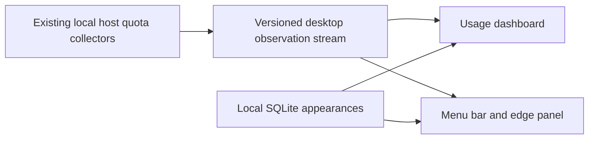
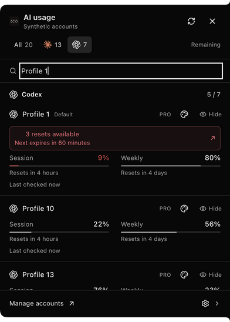
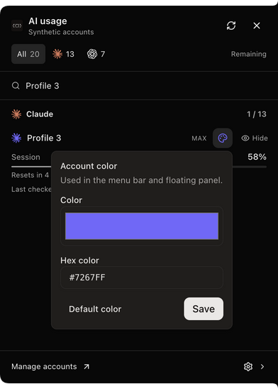
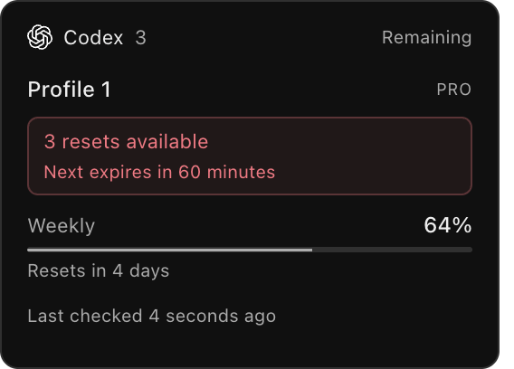

# Desktop usage displays

Optional macOS menu-bar and right-edge views of the locally running host's account quotas. Enable them under **Settings → Appearance → Usage at a glance**. Both displays and reset celebrations are off by default. Opening Usage or these settings can still request usage explicitly.

The collapsed edge includes every account unless it is explicitly hidden. It adds columns as the available display area fills; it does not have a six-account cap. The expanded panel supports search, provider filters, Hide/Show and a full RGB/hex color picker. Account colors identify profiles; separate session and weekly quota arcs retain their green-to-red warning colors. Exhausted accounts show the limiting reset countdown. When a verified purchased balance is available, the compact footer shows that balance; hover retains the reset detail. Prepaid balances keep their currency and their own acquisition time. Missing balances stay missing; zero remains a real reading. Monthly extra-usage spending is not treated as a prepaid wallet.

Quota windows follow the provider response, not the subscription name or the position of a `primary` field. A weekly-only account has one weekly row and one full dial; no Session placeholder is created. Accounts reporting both limits retain two independent arcs. Unknown durations retain the generic provider label; absent quota stays unavailable, never unlimited. The menu-bar preference falls back to an actually reported window if the selected period does not exist. OpenAI's [current pricing documentation](https://learn.chatgpt.com/docs/pricing#what-are-the-usage-limits-for-my-plan), checked October 15, 2026, states that Pro plans have no five-hour limit.

## Data and identity

The widget does not launch providers, change default accounts, refresh authentication, redeem reset credits or manage conversations. Credential revision checks reject late results from replaced sign-ins. Appearance writes require the selected account's current, verified opaque identity. They are scoped to organization and local host; an expired sibling does not block a healthy account.

Every provider window keeps its original observation date. Provider readings remain current for at most 16 minutes; passive Claude readings have a six-minute bound. Last-known usage is marked historical, and a fresh session observation cannot freshen an old weekly window, wallet, or reset inventory. Wallet values have an independent 31-minute display ceiling.

Unknown quota and reset inventory stay unknown. Offline observations are historical and cannot advertise available reset credits or generate celebrations. Optional metadata failures do not discard valid main quota. Codex reset counts use the authoritative main response, consistent with the contract discussed in #7760; optional details only enrich it. Claude eligibility is displayed only when exposed by the provider. Reset notices require a crossed boundary and two corroborating observations; claims deduplicate celebrations.

## Windows and recovery

The panel, hover preview and optional celebration are sandboxed windows with a narrow, validated IPC bridge and a network-denying renderer CSP. They preserve macOS process type when joining Spaces. This does not change the main window's chrome. Renderer retries are bounded; an out-of-memory failure waits for explicit retry. Disposal removes windows, trays, listeners and timers. Hover cannot reopen during an edge transition.

## Verification

Unit/integration tests cover identity rotation, delayed responses, failure isolation, reset metadata/counts/expiry, later reset cycles, disabled-display polling, 8/20/254-account layouts, Hide/Show, arbitrary RGB colors, SQLite upgrade/preservation, healthy/expired sibling accounts, renderer boundaries, hover recovery and IPC/disposal. Local native Electron checks use the actual controller, preload and built renderer with synthetic public quota/coordinator data and isolated SQLite. They also verify weekly-only Pro accounts without Session placeholders and with one full dial. They verify twenty visible accounts, a settled 254-account grid, saved colors across restart, invalid hex rejection, picker fit, Hide/Show and historical offline readings. These are feature integration checks, not a signed-in whole-desktop/provider acceptance run.

Physical display unplug/sleep-wake, live positive Claude reset eligibility and acquisition performance across 254 real profiles are not newly qualified. Provider endpoints can expire, rate-limit or change; the UI must remain explicit about unavailable and stale data.

