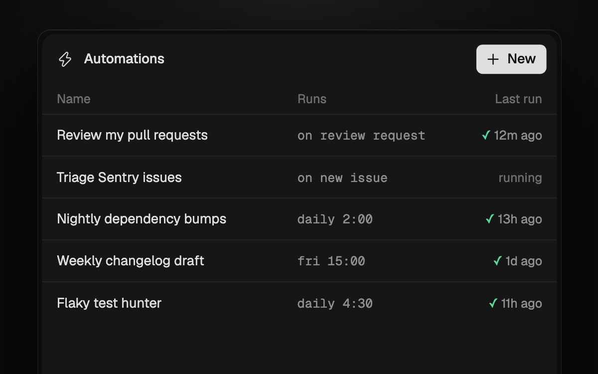
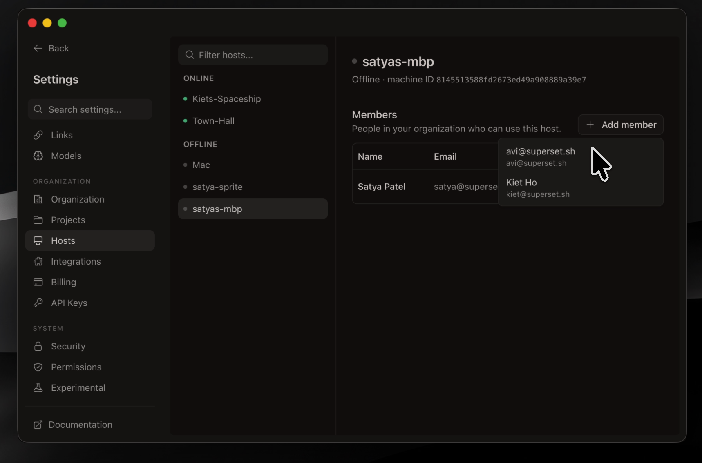
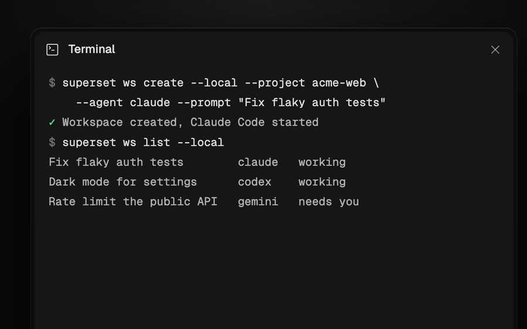

<div align="center">


### Jalankan 100+ Agen Coding Secara Paralel

<details>
<summary>🌐 Baca dalam bahasa lain</summary>
<br />

[English](../README.md) | [日本語](README.ja.md) | [简体中文](README.zh-CN.md) | [繁體中文](README.zh-TW.md) | [한국어](README.ko.md) | [Français](README.fr.md) | [Español](README.es.md) | [Deutsch](README.de.md) | [Português](README.pt-BR.md) | [Italiano](README.it.md) | [Русский](README.ru.md) | [Türkçe](README.tr.md) | [Polski](README.pl.md) | [Nederlands](README.nl.md) | [Bahasa Indonesia](README.id.md) | [Čeština](README.cs.md) | [Tiếng Việt](README.vi.md)

</details>

*Ini adalah terjemahan dari README bahasa Inggris, yang menjadi acuan resmi.*

[](https://github.com/paradevai/paradev/stargazers)
[](https://github.com/paradevai/paradev/releases)
[](../LICENSE.md)
[](https://x.com/paradevai)
[](https://discord.gg/cZeD9WYcV7)

<br />

Claude Code, Codex, atau agen CLI apa pun, masing-masing di worktree terisolasinya sendiri.<br />
Habiskan waktu Anda untuk shipping, bukan menunggu.

<br />

[**Unduh untuk macOS**](https://github.com/paradevai/paradev/releases/latest) &nbsp;&bull;&nbsp; [Dokumentasi](https://docs.paradev.com) &nbsp;&bull;&nbsp; [Changelog](https://github.com/paradevai/paradev/releases) &nbsp;&bull;&nbsp; [Discord](https://discord.gg/cZeD9WYcV7)

<br />


</div>

## Coding 10x Lebih Cepat Tanpa Biaya Berpindah Konteks

Paradev menjalankan agen coding berbasis CLI secara paralel di git worktree yang terisolasi, di terminal atau sebagai chat, dengan alur kerja terminal, review, dan buka-di-editor bawaan.

- **Jalankan banyak agen sekaligus** tanpa beban berpindah konteks
- **Isolasi tiap tugas** di git worktree-nya sendiri sehingga agen tidak saling mengganggu
- **Pantau semua agen Anda** dari satu tempat dan dapatkan notifikasi saat mereka butuh perhatian
- **Review dan edit perubahan dengan cepat** lewat diff viewer dan editor bawaan
- **Buka workspace mana pun di tempat yang Anda butuhkan** dengan serah terima sekali klik ke editor atau terminal Anda
- **Akses workspace Anda dari mana saja** lewat host jarak jauh, CLI, SDK, atau MCP

Lebih sedikit menunggu, lebih banyak shipping.

## Fitur

<table>
<tr>
<td width="50%" valign="middle">

### Workspace Paralel

Jalankan 100+ agen coding sekaligus, masing-masing di git worktree-nya sendiri dengan branch, terminal, dan lingkungannya sendiri. Bandingkan hasilnya dan merge pemenangnya.

[Dokumentasi →](https://docs.paradev.com/workspaces)

</td>
<td width="50%">
  <a href="https://docs.paradev.com/workspaces"></a>
</td>
</tr>
<tr>
<td width="50%" valign="middle">

### Pemantauan Agen

Lacak setiap agen dari sidebar, dengan indikator bekerja, bunyi penanda selesai, dan badge dock saat ada yang butuh perhatian Anda.

[Dokumentasi →](https://docs.paradev.com/agent-integration)

</td>
<td width="50%">
  <a href="https://docs.paradev.com/agent-integration"></a>
</td>
</tr>
<tr>
<td width="50%" valign="middle">

### Terminal Bawaan

Tab, split tanpa batas, preset, dan sesi persisten yang bertahan setelah restart. Tekan ⌘I untuk editor prompt kaya dengan pengeditan multibaris dan mention file dengan @.

[Dokumentasi →](https://docs.paradev.com/terminal-integration)

</td>
<td width="50%">
  <a href="https://docs.paradev.com/terminal-integration"></a>
</td>
</tr>
<tr>
<td width="50%" valign="middle">

### Diff Viewer Bawaan

Periksa, komentari, dan edit perubahan agen tanpa meninggalkan aplikasi, lalu commit dan push saat sudah siap.

[Dokumentasi →](https://docs.paradev.com/diff-viewer)

</td>
<td width="50%">
  <a href="https://docs.paradev.com/diff-viewer"></a>
</td>
</tr>
<tr>
<td width="50%" valign="middle">

### Browser Dalam Aplikasi & Port

Pratinjau server dev yang berjalan di panel browser. Port dideteksi per workspace, jadi setiap worktree mendapat pratinjaunya sendiri.

[Dokumentasi →](https://docs.paradev.com/browser)

</td>
<td width="50%">
  <a href="https://docs.paradev.com/browser"></a>
</td>
</tr>
<tr>
<td width="50%" valign="middle">

### Otomatisasi

Jalankan sesi agen sesuai jadwal: triase issue semalaman, susun draf changelog mingguan, jaga dependensi tetap mutakhir.

[Dokumentasi →](https://docs.paradev.com/automations)

</td>
<td width="50%">
  <a href="https://docs.paradev.com/automations"></a>
</td>
</tr>
<tr>
<td width="50%" valign="middle">

### Akses Jarak Jauh

Hubungkan mesin lain dan akses workspace-nya dari mana saja: aplikasi desktop, CLI, atau ponsel Anda. Bangunkan host yang offline dengan perintah kustom.

[Dokumentasi →](https://docs.paradev.com/remote-access)

</td>
<td width="50%">
  <a href="https://docs.paradev.com/remote-access"></a>
</td>
</tr>
<tr>
<td width="50%" valign="middle">

### Paradev CLI

Skrip dari shell mana pun: buat workspace, luncurkan agen, baca terminal mereka, dan kelola otomatisasi dengan satu binary. Kalau sebuah agen bisa menjalankan perintah, ia bisa mengendalikan Paradev.

[Dokumentasi →](https://docs.paradev.com/cli/getting-started)

</td>
<td width="50%">
  <a href="https://docs.paradev.com/cli/getting-started"></a>
</td>
</tr>
<tr>
<td width="50%" valign="middle">

### Palet Perintah

Lompat ke workspace, aksi, atau pengaturan mana pun dari satu kotak pencarian.

[Dokumentasi →](https://docs.paradev.com/keyboard-shortcuts)

</td>
<td width="50%">
  <a href="https://docs.paradev.com/keyboard-shortcuts"></a>
</td>
</tr>
</table>

**Juga sudah termasuk:**

- **[Skill bawaan](https://docs.paradev.com/skills)**: agen sudah dimuat dengan skill `superset:*` (mengorkestrasi agen paralel, menjadwalkan otomatisasi, mengirim umpan balik, mendiagnosis masalah), disediakan otomatis saat diluncurkan
- **[Pemilih model & agen kustom](https://docs.paradev.com/agent-integration)**: pilih model dan tingkat penalaran saat meluncurkan, dan tambahkan agen terminal apa pun dengan ikonnya sendiri
- **[Skrip setup workspace](https://docs.paradev.com/setup-teardown-scripts)**: otomatiskan setup env, instalasi dependensi, dan server dev per workspace
- **[Preset terminal](https://docs.paradev.com/terminal-presets)**: simpan tata letak agen dan shell lalu buka dengan satu tekanan tombol
- **[Slack & Linear](https://docs.paradev.com/use-with-linear)**: buat workspace dari pesan Slack atau issue Linear
- **[Buka di IDE Anda](https://docs.paradev.com/use-with-ide)**: serah terima sekali klik ke Cursor, VS Code, atau editor apa pun
- **[Tema kustom](https://docs.paradev.com/custom-themes)**: buat, edit, dan impor berkas tema
- **[Pintasan keyboard](https://docs.paradev.com/keyboard-shortcuts)**: setiap aksi bisa dipetakan ulang lewat **Pengaturan → Pintasan Keyboard** (⌘/)
- **[Bawa provider Anda sendiri](https://docs.paradev.com/providers)**: hubungkan OpenRouter, Bedrock, Vertex, atau Vercel AI Gateway
- **Dan masih banyak lagi**: kami shipping setiap hari, jadi daftar ini selalu tertinggal. [Changelog](https://paradev.com/changelog) adalah daftar fitur yang sebenarnya.

## Agen yang Didukung

Paradev bekerja dengan agen coding berbasis CLI apa pun, termasuk:

| Agen | Status |
|:------|:-------|
|  &nbsp;[Amp Code](https://ampcode.com/) | Didukung penuh |
|  &nbsp;[Antigravity CLI](https://antigravity.google/) | Didukung penuh |
|  &nbsp;[Claude Code](https://github.com/anthropics/claude-code) | Didukung penuh |
| <picture><source media="(prefers-color-scheme: dark)" srcset="../packages/ui/src/assets/icons/preset-icons/codex-white.svg" /></picture> &nbsp;[OpenAI Codex CLI](https://github.com/openai/codex) | Didukung penuh |
|  &nbsp;[Cursor Agent](https://docs.cursor.com/agent) | Didukung penuh |
| <picture><source media="(prefers-color-scheme: dark)" srcset="../packages/ui/src/assets/icons/preset-icons/droid-white.svg" /></picture> &nbsp;[Droid](https://www.factory.ai/) | Didukung penuh |
| <picture><source media="(prefers-color-scheme: dark)" srcset="../packages/ui/src/assets/icons/preset-icons/fx-white.svg" /></picture> &nbsp;[fx](https://fx.sh/) | Didukung penuh |
|  &nbsp;[Gemini CLI](https://github.com/google-gemini/gemini-cli) | Didukung penuh |
| <picture><source media="(prefers-color-scheme: dark)" srcset="../packages/ui/src/assets/icons/preset-icons/copilot-white.svg" /></picture> &nbsp;[GitHub Copilot](https://github.com/features/copilot) | Didukung penuh |
| <picture><source media="(prefers-color-scheme: dark)" srcset="../packages/ui/src/assets/icons/preset-icons/grok-white.svg" /></picture> &nbsp;[Grok](https://x.ai/) | Didukung penuh |
| <picture><source media="(prefers-color-scheme: dark)" srcset="../packages/ui/src/assets/icons/preset-icons/hermes-white.svg" /></picture> &nbsp;[Hermes](https://github.com/NousResearch/hermes-agent) | Didukung penuh |
| <picture><source media="(prefers-color-scheme: dark)" srcset="../packages/ui/src/assets/icons/preset-icons/muse-white.svg" /></picture> &nbsp;[Muse Code](https://developer.meta.com/ai/products/muse-code/) | Didukung penuh |
| <picture><source media="(prefers-color-scheme: dark)" srcset="../packages/ui/src/assets/icons/preset-icons/devin-white.svg" /></picture> &nbsp;[Devin](https://devin.ai/cli) | Didukung penuh |
| <picture><source media="(prefers-color-scheme: dark)" srcset="../packages/ui/src/assets/icons/preset-icons/kimi-white.svg" /></picture> &nbsp;[Kimi Code](https://www.kimi.com/) | Didukung penuh |
|  &nbsp;[Kiro](https://kiro.dev/cli/) | Didukung penuh |
| <picture><source media="(prefers-color-scheme: dark)" srcset="../packages/ui/src/assets/icons/preset-icons/mastracode-white.svg" /></picture> &nbsp;[Mastra Code](https://mastra.ai/) | Didukung penuh |
|  &nbsp;[Mistral Vibe](https://mistral.ai/) | Didukung penuh |
| <picture><source media="(prefers-color-scheme: dark)" srcset="../packages/ui/src/assets/icons/preset-icons/pi-white.svg" /></picture> &nbsp;[Oh My Pi](https://github.com/can1357/oh-my-pi) | Didukung penuh |
| <picture><source media="(prefers-color-scheme: dark)" srcset="../packages/ui/src/assets/icons/preset-icons/opencode-white.svg" /></picture> &nbsp;[OpenCode](https://github.com/opencode-ai/opencode) | Didukung penuh |
| <picture><source media="(prefers-color-scheme: dark)" srcset="../packages/ui/src/assets/icons/preset-icons/pi-white.svg" /></picture> &nbsp;[Pi](https://github.com/badlogic/pi-mono/tree/main/packages/coding-agent) | Didukung penuh |
| <picture><source media="(prefers-color-scheme: dark)" srcset="../packages/ui/src/assets/icons/preset-icons/polygraph-white.svg" /></picture> &nbsp;[Polygraph](https://trypolygraph.com/) | Didukung penuh |
| Agen CLI lainnya | Bekerja tanpa konfigurasi |

Kalau bisa berjalan di terminal, ia bisa berjalan di Paradev

Agen mendapat lebih dari sekadar terminal:

- **Pemilih model**: pilih model dan tingkat penalaran saat Anda meluncurkan agen
- **Pengaturan per agen**: atur perintah peluncuran, templat prompt, dan override model di Pengaturan → Agen
- **Agen kustom**: tambahkan agen terminal apa pun dengan ikonnya sendiri dan ia bekerja seperti agen bawaan
- **Status dan notifikasi**: indikator bekerja, bunyi penanda selesai, dan badge dock saat agen membutuhkan Anda
- **Chat bawaan**: bicaralah dengan model di panel chat, dengan persetujuan tool inline dan review rencana

<details>
<summary><strong>Pertanyaan Umum</strong></summary>
<br />

<details>
<summary>Apakah Paradev aplikasi terminal atau aplikasi desktop?</summary>
<br />

Paradev adalah aplikasi desktop, bukan aplikasi terminal. Agen berjalan di dalamnya sebagai chat atau di terminal. Di sampingnya ada diff viewer, pull request, browser dalam aplikasi, dan editor file. [Dokumentasi FAQ](https://docs.paradev.com/faq)

</details>

<details>
<summary>Apakah saya harus memakai terminal, atau bisa chat dengan agen coding?</summary>
<br />

Tidak harus. Paradev bisa menampilkan sesi agen sebagai chat alih-alih terminal, dan Anda menyetujui atau menolak tindakan agen dengan sekali klik. Chat bisa dipakai dengan Claude Code, Codex, OpenCode, dan Pi; Paradev menjalankan CLI yang sudah Anda instal, jadi login dan pengaturan Anda tetap terpakai. Toggle **CLI** / **Chat** mengganti mode sesi yang sedang berjalan tanpa kehilangan konteks, dan agen lain berjalan di terminal Paradev. [Dokumentasi Chat](https://docs.paradev.com/chat)

</details>

<details>
<summary>Apa lisensi Paradev, berapa biayanya, dan di platform apa saja ia berjalan?</summary>
<br />

Paradev adalah open source dengan Lisensi MIT. Paket Free mencakup workspace lokal dengan aplikasi desktop dan CLI. Paket berbayar menambahkan fitur seperti otomatisasi dan workspace cloud. Aplikasi desktop berjalan di macOS dan Linux; Windows belum tersedia. [Harga](https://paradev.com/pricing) · [Dokumentasi FAQ](https://docs.paradev.com/faq)

</details>

<details>
<summary>Apakah Paradev sama dengan Superset? Apakah ada hubungannya dengan Apache Superset?</summary>
<br />

Paradev sebelumnya bernama Superset, itulah sebabnya perintah CLI-nya masih `superset`. Paradev tidak berhubungan dengan Apache Superset, tool business intelligence. [Dokumentasi instalasi](https://docs.paradev.com/install)

</details>

<details>
<summary>Agen coding apa saja yang didukung Paradev, dan apakah saya tetap memakai langganan saya sendiri?</summary>
<br />

Paradev punya dukungan bawaan untuk Claude Code, Codex, OpenCode, Cursor Agent, Gemini CLI, Amp, dan lainnya, dan Anda bisa menambahkan agen CLI lain apa pun. Claude Code, Codex, OpenCode, dan Pi juga bisa berjalan sebagai chat. Agen memakai langganan dan API key Anda sendiri, dan Paradev tidak mem-proxy panggilan model. [Dokumentasi agen yang didukung](https://docs.paradev.com/supported-agents)

</details>

<details>
<summary>Bagaimana mencegah beberapa agen coding saling menimpa pekerjaan di satu repositori?</summary>
<br />

Paradev memberi setiap agen workspace-nya sendiri: sebuah git worktree di branch-nya sendiri, dengan terminalnya sendiri. Agen mengedit salinan file kerja yang terpisah, jadi satu agen tidak menimpa perubahan agen lain. Worktree tidak mengisolasi proses dalam sandbox, dan branch tetap bisa konflik saat Anda menggabungkannya. [Dokumentasi workspace](https://docs.paradev.com/workspaces)

</details>

<details>
<summary>Sesi terminal Claude Code saya terlalu banyak. Bagaimana cara melacaknya?</summary>
<br />

Paradev menampilkan setiap sesi agen di satu sidebar, dikelompokkan per proyek, dengan status untuk masing-masing, baik sesi itu berjalan sebagai chat maupun di terminal. Claude Code melaporkan saat ia selesai dan saat menunggu input Anda, dan sidebar menandai workspace yang membutuhkan Anda. [Dokumentasi status agen](https://docs.paradev.com/agent-status)

</details>

<details>
<summary>Bisakah saya menjalankan dua agen coding pada tugas yang sama lalu membandingkan hasilnya?</summary>
<br />

Bisa. Di Paradev Anda memberikan prompt yang sama ke dua workspace atau lebih, masing-masing di branch-nya sendiri, dengan agen yang sama atau agen yang berbeda. Lalu Anda membandingkan diff-nya dan menyimpan hasil terbaik. [Resep balapan agen](https://docs.paradev.com/recipes/race-agents)

</details>

<details>
<summary>Bisakah saya memakai Claude Code dan Codex bersamaan, satu menulis kode dan yang lain me-review-nya?</summary>
<br />

Bisa. Paradev menjalankan Claude Code dan Codex berdampingan, masing-masing sebagai chat atau di terminal. Untuk mendapat review, pilih baris di tab **Code** sebuah pull request lalu kirim ke agen lain, atau gunakan **Continue with another agent** untuk memulai sesi agen lain dengan konteks terbaru. [Dokumentasi sesi agen](https://docs.paradev.com/agent-sessions)

</details>

<details>
<summary>Bagaimana cara me-review diff agen coding dan mengirim tindak lanjut sebelum merge?</summary>
<br />

Paradev menampilkan perubahan setiap workspace di diff viewer, tempat Anda melakukan commit, push, dan membuka pull request. Di tab **Code** pull request, pilih baris lalu kirim komentar ke agen yang sedang berjalan atau ke sesi baru; memposting komentar itu ke GitHub bersifat opsional. Anda bisa memantau check dan melakukan merge dari tampilan yang sama. [Dokumentasi pull request](https://docs.paradev.com/pull-requests)

</details>

<details>
<summary>Bagaimana cara memisahkan server dev, port, dan pratinjau tiap branch?</summary>
<br />

Paradev menyimpan setiap branch di worktree-nya sendiri dan menampilkan port yang didengarkan oleh proses tiap workspace, dikelompokkan per workspace. Pilih sebuah port untuk membuka server dev branch tersebut di browser dalam aplikasi. Paradev tidak menetapkan rentang port, jadi atur konfigurasi per workspace di skrip setup, yang berjalan di setiap workspace baru dengan variabel seperti `SUPERSET_WORKSPACE_PATH`. [Dokumentasi port](https://docs.paradev.com/ports)

</details>

<details>
<summary>Bisakah saya mengklik elemen di aplikasi web yang sedang berjalan lalu meminta agen coding mengubahnya?</summary>
<br />

Bisa. Paradev punya mode Design di browser dalam aplikasinya: buka server dev Anda, nyalakan **Design**, lalu klik elemennya. Kemudian Anda menjelaskan perubahannya, dan agen menerima detail elemen serta screenshot beserta catatan Anda. [Dokumentasi browser](https://docs.paradev.com/browser)

</details>

<details>
<summary>Bisakah saya mendapat notifikasi saat agen coding membutuhkan input saya?</summary>
<br />

Bisa. Aplikasi desktop Paradev memberi tahu Anda saat agen selesai atau berhenti menunggu input Anda, dan ikon Dock macOS menampilkan badge. Dukungannya bergantung pada agen: Claude Code melaporkan kedua kondisi, sementara beberapa agen hanya melaporkan saat selesai. Di aplikasi mobile, sebuah titik pada workspace menandakan agen membutuhkan izin Anda; push notification belum tersedia. [Dokumentasi status agen](https://docs.paradev.com/agent-status)

</details>

<details>
<summary>Bisakah saya memantau agen coding dan membalasnya dari iPhone?</summary>
<br />

Bisa. Paradev untuk iPhone dan iPad memungkinkan Anda memulai agen, mengikuti sesinya secara langsung, membalasnya, dan me-review perubahannya. Dibutuhkan iOS 26 atau iPadOS 26 ke atas dan Paradev Pro, dan ada juga aplikasi Android di Google Play. Untuk workspace di komputer Anda, aktifkan akses jarak jauh dan biarkan komputer tetap menyala dan online. [Dokumentasi aplikasi mobile](https://docs.paradev.com/mobile)

</details>

<details>
<summary>Bisakah agen coding berjalan sesuai jadwal, misalnya maintenance malam hari atau pengecekan flaky test mingguan?</summary>
<br />

Bisa. Otomatisasi Paradev menjalankan agen dengan jadwal per jam, harian, mingguan, atau kustom. Setiap run membuat workspace tempat Anda me-review perubahan dan melanjutkan pekerjaan. Otomatisasi membutuhkan paket Pro. [Dokumentasi otomatisasi](https://docs.paradev.com/automations)

</details>

<details>
<summary>Bisakah saya memulai agen coding dari Slack, Linear, Sentry, atau pull request GitHub?</summary>
<br />

Bisa. Otomatisasi Paradev memulai agen saat ada event pull request GitHub, pesan Slack, issue Linear, issue Sentry, atau webhook yang masuk, dan agen menerima detail event tersebut bersama prompt Anda. Anda juga bisa me-mention bot Paradev di Slack untuk memulai workspace cloud dan agen. Otomatisasi dan integrasi Slack membutuhkan paket Pro. [Dokumentasi otomatisasi](https://docs.paradev.com/automations)

</details>

<details>
<summary>Bisakah saya memulai agen coding dari command line atau dari agen lain?</summary>
<br />

Bisa. Paradev CLI membuat workspace dan memulai agen di dalamnya dari skrip shell atau dari agen lain. Agen juga bisa memakai server MCP Paradev untuk bekerja dengan workspace dan terminal. Aplikasi desktop menyertakan skill orchestrate yang memungkinkan satu agen mengoordinasikan worker di workspace terpisah. [Dokumentasi CLI](https://docs.paradev.com/cli/getting-started)

</details>

<details>
<summary>Bisakah saya menjalankan agen coding di mesin jarak jauh atau di cloud dan me-review perubahannya dari laptop?</summary>
<br />

Bisa. Dengan akses jarak jauh Paradev (paket Pro), Anda membuka workspace yang di-host di mesin lain, seperti Mac mini atau server, dari laptop Anda. Workspace cloud (paket Team dan Ultra) menjalankan setiap workspace di mesin cloud-nya sendiri, jadi agen tetap bekerja saat laptop Anda tertutup. [Dokumentasi akses jarak jauh](https://docs.paradev.com/remote-access)

</details>

<details>
<summary>Bisakah saya kembali ke sebuah tugas nanti dengan sesi agen dan branch-nya masih ada?</summary>
<br />

Bisa. Workspace Paradev tetap ada di disk sebagai git worktree di branch-nya sampai Anda menghapusnya. Terminal dimiliki oleh proses latar belakang, jadi terminal tetap berjalan dan menyimpan scrollback-nya saat Anda menutup atau memperbarui aplikasi. Jika terminal berhenti setelah crash atau restart, Paradev bisa melanjutkan sesi agen untuk agen yang mendukung resume, seperti Claude Code dan Codex. [Dokumentasi menjaga agen tetap berjalan](https://docs.paradev.com/keep-agents-running)

</details>

<details>
<summary>Bisakah tim kecil berbagi satu mesin untuk agen coding?</summary>
<br />

Bisa. Host Paradev bisa berupa mesin bersama, seperti Mac mini, yang diakses rekan tim lewat akses jarak jauh (paket Pro). Saat host pertama kali online, hanya orang yang menjalankannya yang punya akses. Orang tersebut menambahkan rekan tim di **Settings → Hosts**. [Dokumentasi akses jarak jauh](https://docs.paradev.com/remote-access)

</details>

<details>
<summary>Apa bedanya Paradev dengan Conductor, Orca, dan Cursor?</summary>
<br />

Paradev, Conductor, dan Orca sama-sama menjalankan agen coding di git worktree paralel, sedangkan Cursor adalah editor AI yang dibangun di sekitar agennya sendiri. Paradev menjalankan agen CLI apa pun dengan langganan Anda sendiri, dan membuka workspace di Cursor saat Anda ingin mengedit di sana. Orca juga open source dan berjalan di Windows, yang belum didukung Paradev. Conductor sedang bergabung dengan Meta dan tertutup untuk pengguna baru, dan Paradev punya panduan untuk memindahkan workspace Conductor. [Migrasi dari Conductor](https://docs.paradev.com/migrate-from-conductor)

</details>

<details>
<summary>Apakah Paradev bisa menggantikan tmux?</summary>
<br />

Bisa, untuk menjalankan agen coding Paradev dapat menggantikan tmux: sesi terminalnya tetap berjalan saat Anda menutup, keluar dari, atau memperbarui aplikasi. Setiap workspace juga mendapat worktree dan status sendiri di sidebar. Anda tetap bisa menjalankan tmux di dalam terminal Paradev. [Dokumentasi menjaga agen tetap berjalan](https://docs.paradev.com/keep-agents-running)

</details>

</details>

## Lebih dari Sekadar Aplikasi Desktop

Setiap permukaan berbicara dengan workspace yang sama, jadi Anda bisa memulai tugas di aplikasi dan memeriksanya dari mana saja.

| Permukaan | Yang Anda dapat |
|:--------|:-------------|
| [**Aplikasi Desktop**](https://github.com/paradevai/paradev/releases/latest) | IDE lengkap: terminal, diff viewer, browser dalam aplikasi, otomatisasi |
| [**CLI**](https://docs.paradev.com/cli/getting-started) | Satu binary `superset` untuk mengelola workspace, agen, terminal, dan host dari shell mana pun |
| [**TypeScript SDK**](https://docs.paradev.com/sdk/getting-started) | Kendalikan Paradev secara programatik dengan [`@superset_sh/sdk`](https://www.npmjs.com/package/@superset_sh/sdk) dari Node, Bun, atau Deno |
| [**MCP Server**](https://docs.paradev.com/mcp) | Biarkan Claude Code, Codex, Cursor, dan agen lainnya membuat dan mengelola workspace sendiri |

CLI sudah dibundel dengan aplikasi desktop, atau pasang secara terpisah:

```bash
curl -fsSL https://paradev.com/cli/install.sh | sh
# or
brew install paradevai/tap/superset
```

Aplikasi iOS segera hadir sehingga Anda bisa memantau agen dari ponsel.

## Instalasi

Unduh aplikasi desktop:

- **macOS**: [Apple Silicon (.dmg)](https://github.com/paradevai/paradev/releases/latest/download/Superset-arm64.dmg) · [Intel (.dmg)](https://github.com/paradevai/paradev/releases/latest/download/Superset-x64.dmg)
- **Linux**: [x64 AppImage](https://github.com/paradevai/paradev/releases/latest/download/Paradev-x86_64.AppImage)
- **Windows**: belum tersedia
- [Semua build](https://github.com/paradevai/paradev/releases/latest)

Yang perlu terpasang hanya [Git](https://git-scm.com/). [gh](https://cli.github.com/) bersifat opsional dan membuka alur kerja PR; Paradev menawarkan untuk memasangnya bagi Anda.

## Pengembangan

Ingin mengutak-atik Paradev atau menyumbang PR? Clone repositorinya, tambahkan ke
aplikasi Paradev yang terpasang, lalu buat workspace untuk perubahan Anda:

```bash
git clone https://github.com/paradevai/paradev.git
```

Lalu jalankan setup pengembangan dari terminal workspace tersebut:

```bash
./.paradev/setup.local.sh
bun run dev
```

Jalankan `setup.local.sh` sekali di setiap worktree baru. Skrip ini mengonfigurasi identitas
aplikasi dan port yang spesifik per workspace, sehingga aplikasi desktop versi pengembangan
bisa berjalan berdampingan dengan aplikasi Paradev yang terpasang dan worktree pengembangan lainnya.

Tidak perlu akun Neon atau kredensial pihak ketiga. `setup.local.sh` menyiapkan
stack Postgres + Electric lokal via Docker dan mengisi akun dev. Masuk
dengan tombol **"Sign in as dev"** (atau `admin@local.test` / `supersetdev`).

Prasyarat: [Bun](https://bun.sh/) v1.4.3+ (dipatok di `.bun-version`), `docker`, `jq`, dan `caddy`, yang dijalankan `bun dev` sebagai proxy HTTPS lokal (`brew install jq caddy && caddy trust`).

Lihat [**DEVELOPMENT.md**](../DEVELOPMENT.md) untuk panduan lengkap: apa yang dilakukan skrip setup, setup manual dengan layanan sungguhan, perintah umum, pemecahan masalah, dan cara mem-build aplikasi desktop. Proses kontribusi ada di [**CONTRIBUTING.md**](../CONTRIBUTING.md).

## Konfigurasi

Konfigurasikan skrip setup, teardown, dan run workspace di `.paradev/config.json`. Lihat [dokumentasi lengkap](https://docs.paradev.com/setup-teardown-scripts).

```json
{
  "setup": ["./.paradev/setup.sh"],
  "teardown": ["./.paradev/teardown.sh"],
  "run": ["./.paradev/run.sh"]
}
```

Pintasan keyboard bisa dikustomisasi lewat **Pengaturan → Pintasan Keyboard** (⌘/); lihat [daftar pintasan lengkap](https://docs.paradev.com/keyboard-shortcuts).

## Tech Stack

<p>
  <a href="https://www.electronjs.org/"></a>
  <a href="https://reactjs.org/"></a>
  <a href="https://tailwindcss.com/"></a>
  <a href="https://bun.sh/"></a>
  <a href="https://turbo.build/"></a>
  <a href="https://vitejs.dev/"></a>
  <a href="https://biomejs.dev/"></a>
  <a href="https://orm.drizzle.team/"></a>
  <a href="https://neon.tech/"></a>
  <a href="https://trpc.io/"></a>
</p>

## Privat Secara Default

- **Koneksi eksplisit**: Anda yang memilih agen, provider, dan integrasi mana yang dihubungkan.

## Berkontribusi

Kami menyambut kontribusi! Lihat [CONTRIBUTING.md](../CONTRIBUTING.md) untuk cara menyiapkan lingkungan dan membuka PR. Bug dan permintaan fitur masuk ke [issues](https://github.com/paradevai/paradev/issues).

<a href="https://github.com/paradevai/paradev/graphs/contributors">
  
</a>

## Komunitas

Bergabunglah dengan komunitas Paradev untuk mendapat bantuan, berbagi umpan balik, dan terhubung dengan pengguna lain:

- **[Discord](https://discord.gg/cZeD9WYcV7)**: mengobrol dengan tim dan komunitas
- **[Twitter](https://x.com/paradevai)**: ikuti untuk pembaruan dan pengumuman
- **[GitHub Issues](https://github.com/paradevai/paradev/issues)**: laporkan bug dan ajukan permintaan fitur
- **[GitHub Discussions](https://github.com/paradevai/paradev/discussions)**: ajukan pertanyaan dan bagikan ide

### Tim

[](https://x.com/avimakesrobots)
[](https://x.com/flyakiet)
[](https://x.com/saddle_paddle)

## Lisensi & yang gratis selamanya

**Aplikasi desktop gratis selamanya.** Menjalankan agen secara paralel di mesin Anda sendiri tidak akan pernah memerlukan pembayaran. Apa pun yang kami kenakan biaya akan berupa layanan opsional di atasnya.

Seluruh aplikasi ada di repositori ini di bawah [Lisensi MIT](../LICENSE.md): gunakan, fork, modifikasi, self-host, dan distribusikan ulang.
