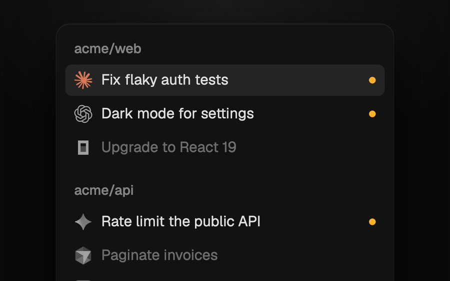
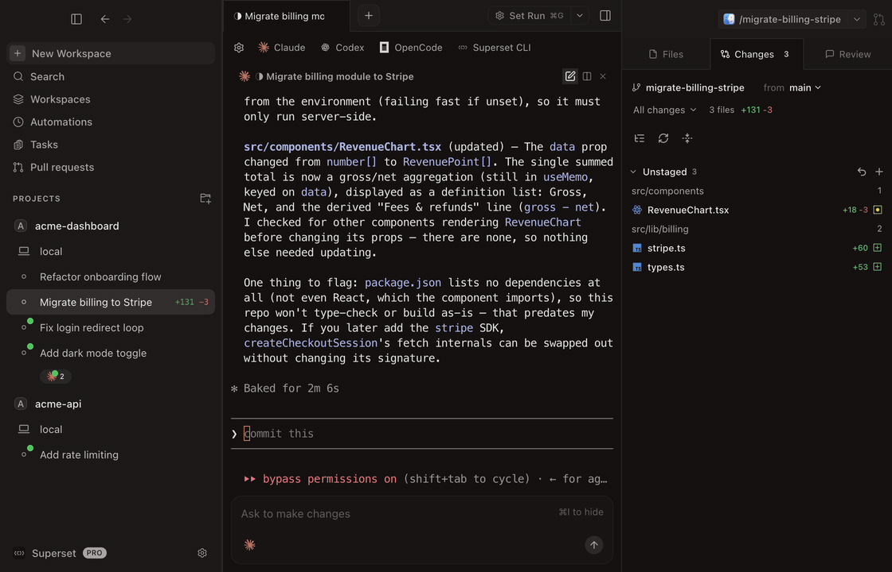

<div align="center">


### Esegui più di 100 agenti di coding in parallelo

<details>
<summary>🌐 Leggi in altre lingue</summary>
<br />

[English](../README.md) | [日本語](README.ja.md) | [简体中文](README.zh-CN.md) | [繁體中文](README.zh-TW.md) | [한국어](README.ko.md) | [Français](README.fr.md) | [Español](README.es.md) | [Deutsch](README.de.md) | [Português](README.pt-BR.md) | [Italiano](README.it.md) | [Русский](README.ru.md) | [Türkçe](README.tr.md) | [Polski](README.pl.md) | [Nederlands](README.nl.md) | [Bahasa Indonesia](README.id.md) | [Čeština](README.cs.md) | [Tiếng Việt](README.vi.md)

</details>

*Traduzione del README in inglese, che resta la versione di riferimento.*

[](https://github.com/paradevai/paradev/stargazers)
[](https://github.com/paradevai/paradev/releases)
[](../LICENSE.md)
[](https://x.com/paradevai)
[](https://discord.gg/cZeD9WYcV7)

<br />

Claude Code, Codex o qualsiasi agente CLI, ognuno nel proprio worktree isolato.<br />
Passa il tempo a rilasciare, non ad aspettare.

<br />

[**Scarica per macOS**](https://github.com/paradevai/paradev/releases/latest) &nbsp;&bull;&nbsp; [Documentazione](https://docs.paradev.com) &nbsp;&bull;&nbsp; [Changelog](https://github.com/paradevai/paradev/releases) &nbsp;&bull;&nbsp; [Discord](https://discord.gg/cZeD9WYcV7)

<br />


</div>

## Scrivi codice 10 volte più veloce, senza costi di cambio contesto

Paradev esegue agenti di coding CLI in parallelo su worktree git isolati, in un terminale o come chat, con terminale integrato, revisione delle modifiche e apertura diretta nell'editor.

- **Esegui più agenti contemporaneamente** senza l'overhead del cambio di contesto
- **Isola ogni attività** nel proprio worktree git, così gli agenti non interferiscono tra loro
- **Monitora tutti i tuoi agenti** da un unico posto e ricevi una notifica quando serve il tuo intervento
- **Rivedi e modifica le modifiche rapidamente** con il visualizzatore di diff e l'editor integrati
- **Apri qualsiasi workspace dove ti serve** con il passaggio in un clic al tuo editor o terminale
- **Raggiungi i tuoi workspace da ovunque** tramite host remoti, la CLI, l'SDK o MCP

Aspetta meno, rilascia di più.

## Funzionalità

<table>
<tr>
<td width="50%" valign="middle">

### Workspace paralleli

Esegui più di 100 agenti di coding alla volta, ognuno nel proprio worktree git con il proprio branch, terminale e ambiente. Confronta i risultati e fai il merge del migliore.

[Documentazione →](https://docs.paradev.com/workspaces)

</td>
<td width="50%">
  <a href="https://docs.paradev.com/workspaces"></a>
</td>
</tr>
<tr>
<td width="50%" valign="middle">

### Monitoraggio degli agenti

Tieni traccia di ogni agente dalla barra laterale, con indicatori di lavoro, suoni di completamento e badge nel dock quando uno richiede la tua attenzione.

[Documentazione →](https://docs.paradev.com/agent-integration)

</td>
<td width="50%">
  <a href="https://docs.paradev.com/agent-integration"></a>
</td>
</tr>
<tr>
<td width="50%" valign="middle">

### Terminale integrato

Schede, split infiniti, preset e sessioni persistenti che sopravvivono ai riavvii. Premi ⌘I per un editor di prompt avanzato con modifica multilinea e menzioni @-file.

[Documentazione →](https://docs.paradev.com/terminal-integration)

</td>
<td width="50%">
  <a href="https://docs.paradev.com/terminal-integration"></a>
</td>
</tr>
<tr>
<td width="50%" valign="middle">

### Visualizzatore di diff integrato

Ispeziona, commenta e modifica le modifiche degli agenti senza uscire dall'app, poi fai commit e push quando è tutto pronto.

[Documentazione →](https://docs.paradev.com/diff-viewer)

</td>
<td width="50%">
  <a href="https://docs.paradev.com/diff-viewer"></a>
</td>
</tr>
<tr>
<td width="50%" valign="middle">

### Browser in-app e porte

Visualizza in anteprima i dev server in esecuzione in un pannello browser. Le porte vengono rilevate per workspace, così ogni worktree ha la propria anteprima.

[Documentazione →](https://docs.paradev.com/browser)

</td>
<td width="50%">
  <a href="https://docs.paradev.com/browser"></a>
</td>
</tr>
<tr>
<td width="50%" valign="middle">

### Automazioni

Esegui sessioni di agenti su pianificazione: fai il triage delle issue durante la notte, prepara la bozza del changelog settimanale, mantieni aggiornate le dipendenze.

[Documentazione →](https://docs.paradev.com/automations)

</td>
<td width="50%">
  <a href="https://docs.paradev.com/automations"></a>
</td>
</tr>
<tr>
<td width="50%" valign="middle">

### Accesso remoto

Collega un'altra macchina e raggiungi i suoi workspace da ovunque: l'app desktop, la CLI o il tuo telefono. Riattiva gli host offline con un comando personalizzato.

[Documentazione →](https://docs.paradev.com/remote-access)

</td>
<td width="50%">
  <a href="https://docs.paradev.com/remote-access"></a>
</td>
</tr>
<tr>
<td width="50%" valign="middle">

### CLI di Paradev

Scriptalo da qualsiasi shell: crea workspace, avvia agenti, leggi i loro terminali e gestisci le automazioni con un singolo binario. Se un agente può eseguire un comando, può pilotare Paradev.

[Documentazione →](https://docs.paradev.com/cli/getting-started)

</td>
<td width="50%">
  <a href="https://docs.paradev.com/cli/getting-started"></a>
</td>
</tr>
<tr>
<td width="50%" valign="middle">

### Palette dei comandi

Salta a qualsiasi workspace, azione o impostazione da un'unica casella di ricerca.

[Documentazione →](https://docs.paradev.com/keyboard-shortcuts)

</td>
<td width="50%">
  <a href="https://docs.paradev.com/keyboard-shortcuts"></a>
</td>
</tr>
</table>

**Inclusi nella confezione:**

- **[Skill integrate](https://docs.paradev.com/skills)**: gli agenti arrivano precaricati con le skill `superset:*` (orchestrare agenti paralleli, pianificare automazioni, inviare feedback, diagnosticare problemi), fornite automaticamente all'avvio
- **[Selettore di modello e agenti personalizzati](https://docs.paradev.com/agent-integration)**: scegli un modello e il livello di ragionamento all'avvio, e aggiungi qualsiasi agente da terminale con la propria icona
- **[Script di setup del workspace](https://docs.paradev.com/setup-teardown-scripts)**: automatizza la configurazione dell'ambiente, l'installazione delle dipendenze e i dev server per ogni workspace
- **[Preset del terminale](https://docs.paradev.com/terminal-presets)**: salva layout di agenti e shell e aprili con un solo tasto
- **[Slack e Linear](https://docs.paradev.com/use-with-linear)**: crea workspace da messaggi Slack o issue Linear
- **[Apri nel tuo IDE](https://docs.paradev.com/use-with-ide)**: passaggio in un clic a Cursor, VS Code o qualsiasi editor
- **[Temi personalizzati](https://docs.paradev.com/custom-themes)**: crea, modifica e importa file di tema
- **[Scorciatoie da tastiera](https://docs.paradev.com/keyboard-shortcuts)**: ogni azione è rimappabile in **Impostazioni → Scorciatoie da tastiera** (⌘/)
- **[Porta i tuoi provider](https://docs.paradev.com/providers)**: collega OpenRouter, Bedrock, Vertex o Vercel AI Gateway
- **E molto altro**: rilasciamo ogni giorno, quindi questa lista è perennemente indietro. Il [changelog](https://paradev.com/changelog) è la vera lista delle funzionalità.

## Agenti supportati

Paradev funziona con qualsiasi agente di coding basato su CLI, tra cui:

| Agente | Stato |
|:------|:-------|
|  &nbsp;[Amp Code](https://ampcode.com/) | Supporto completo |
|  &nbsp;[Antigravity CLI](https://antigravity.google/) | Supporto completo |
|  &nbsp;[Claude Code](https://github.com/anthropics/claude-code) | Supporto completo |
| <picture><source media="(prefers-color-scheme: dark)" srcset="../packages/ui/src/assets/icons/preset-icons/codex-white.svg" /></picture> &nbsp;[OpenAI Codex CLI](https://github.com/openai/codex) | Supporto completo |
|  &nbsp;[Cursor Agent](https://docs.cursor.com/agent) | Supporto completo |
| <picture><source media="(prefers-color-scheme: dark)" srcset="../packages/ui/src/assets/icons/preset-icons/droid-white.svg" /></picture> &nbsp;[Droid](https://www.factory.ai/) | Supporto completo |
| <picture><source media="(prefers-color-scheme: dark)" srcset="../packages/ui/src/assets/icons/preset-icons/fx-white.svg" /></picture> &nbsp;[fx](https://fx.sh/) | Supporto completo |
|  &nbsp;[Gemini CLI](https://github.com/google-gemini/gemini-cli) | Supporto completo |
| <picture><source media="(prefers-color-scheme: dark)" srcset="../packages/ui/src/assets/icons/preset-icons/copilot-white.svg" /></picture> &nbsp;[GitHub Copilot](https://github.com/features/copilot) | Supporto completo |
| <picture><source media="(prefers-color-scheme: dark)" srcset="../packages/ui/src/assets/icons/preset-icons/grok-white.svg" /></picture> &nbsp;[Grok](https://x.ai/) | Supporto completo |
| <picture><source media="(prefers-color-scheme: dark)" srcset="../packages/ui/src/assets/icons/preset-icons/hermes-white.svg" /></picture> &nbsp;[Hermes](https://github.com/NousResearch/hermes-agent) | Supporto completo |
| <picture><source media="(prefers-color-scheme: dark)" srcset="../packages/ui/src/assets/icons/preset-icons/muse-white.svg" /></picture> &nbsp;[Muse Code](https://developer.meta.com/ai/products/muse-code/) | Supporto completo |
| <picture><source media="(prefers-color-scheme: dark)" srcset="../packages/ui/src/assets/icons/preset-icons/devin-white.svg" /></picture> &nbsp;[Devin](https://devin.ai/cli) | Supporto completo |
| <picture><source media="(prefers-color-scheme: dark)" srcset="../packages/ui/src/assets/icons/preset-icons/kimi-white.svg" /></picture> &nbsp;[Kimi Code](https://www.kimi.com/) | Supporto completo |
|  &nbsp;[Kiro](https://kiro.dev/cli/) | Supporto completo |
| <picture><source media="(prefers-color-scheme: dark)" srcset="../packages/ui/src/assets/icons/preset-icons/mastracode-white.svg" /></picture> &nbsp;[Mastra Code](https://mastra.ai/) | Supporto completo |
|  &nbsp;[Mistral Vibe](https://mistral.ai/) | Supporto completo |
| <picture><source media="(prefers-color-scheme: dark)" srcset="../packages/ui/src/assets/icons/preset-icons/pi-white.svg" /></picture> &nbsp;[Oh My Pi](https://github.com/can1357/oh-my-pi) | Supporto completo |
| <picture><source media="(prefers-color-scheme: dark)" srcset="../packages/ui/src/assets/icons/preset-icons/opencode-white.svg" /></picture> &nbsp;[OpenCode](https://github.com/opencode-ai/opencode) | Supporto completo |
| <picture><source media="(prefers-color-scheme: dark)" srcset="../packages/ui/src/assets/icons/preset-icons/pi-white.svg" /></picture> &nbsp;[Pi](https://github.com/badlogic/pi-mono/tree/main/packages/coding-agent) | Supporto completo |
| <picture><source media="(prefers-color-scheme: dark)" srcset="../packages/ui/src/assets/icons/preset-icons/polygraph-white.svg" /></picture> &nbsp;[Polygraph](https://trypolygraph.com/) | Supporto completo |
| Qualsiasi altro agente CLI | Funziona senza configurazione |

Se gira in un terminale, gira su Paradev

Gli agenti ottengono più di un semplice terminale:

- **Selettore di modello**: scegli un modello e il livello di ragionamento quando avvii un agente
- **Impostazioni per agente**: regola comandi di avvio, template di prompt e override dei modelli in Impostazioni → Agenti
- **Agenti personalizzati**: aggiungi qualsiasi agente da terminale con la propria icona e funzionerà come uno integrato
- **Stato e notifiche**: indicatori di lavoro, suoni di completamento e badge nel dock quando un agente ha bisogno di te
- **Chat integrata**: parla con i modelli in un pannello di chat, con approvazioni degli strumenti inline e revisione dei piani

<details>
<summary><strong>Domande frequenti</strong></summary>
<br />

<details>
<summary>Paradev è un'app da terminale o un'app desktop?</summary>
<br />

Paradev è un'app desktop, non un'app da terminale. Gli agenti girano al suo interno come chat o in un terminale. Accanto hai un visualizzatore di diff, le pull request, un browser in-app e un editor di file. [Documentazione FAQ](https://docs.paradev.com/faq)

</details>

<details>
<summary>Devo usare un terminale, o posso chattare con l'agente di coding?</summary>
<br />

No, Paradev può mostrare una sessione dell'agente come chat invece che come terminale, e approvi o rifiuti le azioni dell'agente con un clic. La chat funziona con Claude Code, Codex, OpenCode e Pi; Paradev esegue la CLI che hai già installato, quindi mantiene il tuo login e le tue impostazioni. Il selettore **CLI** / **Chat** cambia modalità a una sessione in corso senza perdere il contesto, e gli altri agenti girano in un terminale Paradev. [Documentazione della chat](https://docs.paradev.com/chat)

</details>

<details>
<summary>Con quale licenza è distribuito Paradev, quanto costa e su quali piattaforme funziona?</summary>
<br />

Paradev è open source con licenza MIT. Il piano Free copre i workspace locali con l'app desktop e la CLI. I piani a pagamento aggiungono funzionalità come le automazioni e i workspace cloud. L'app desktop funziona su macOS e Linux; Windows non è ancora disponibile. [Prezzi](https://paradev.com/pricing) · [Documentazione FAQ](https://docs.paradev.com/faq)

</details>

<details>
<summary>Paradev è la stessa cosa di Superset? Ha a che fare con Apache Superset?</summary>
<br />

Paradev si chiamava prima Superset, per questo il comando della CLI è ancora `superset`. Non ha nulla a che fare con Apache Superset, lo strumento di business intelligence. [Documentazione di installazione](https://docs.paradev.com/install)

</details>

<details>
<summary>Quali agenti di coding supporta Paradev, e posso usare i miei abbonamenti?</summary>
<br />

Paradev supporta nativamente Claude Code, Codex, OpenCode, Cursor Agent, Gemini CLI, Amp e altri, e puoi aggiungere qualsiasi altro agente CLI. Claude Code, Codex, OpenCode e Pi possono girare anche come chat. Gli agenti usano i tuoi abbonamenti e le tue chiavi API, e Paradev non fa da proxy per le chiamate ai modelli. [Documentazione sugli agenti supportati](https://docs.paradev.com/supported-agents)

</details>

<details>
<summary>Come evito che più agenti di coding si sovrascrivano a vicenda nello stesso repository?</summary>
<br />

Paradev dà a ogni agente il proprio workspace: un worktree Git sul proprio branch, con il proprio terminale. Gli agenti modificano copie separate dei file di lavoro, quindi un agente non sovrascrive le modifiche di un altro. I worktree non isolano i processi in una sandbox, e i branch possono comunque andare in conflitto quando li unisci con un merge. [Documentazione sui workspace](https://docs.paradev.com/workspaces)

</details>

<details>
<summary>Ho troppe sessioni di Claude Code nel terminale. Come faccio a tenerne traccia?</summary>
<br />

Paradev mostra ogni sessione degli agenti in un'unica barra laterale, raggruppata per progetto e con uno stato per ciascuna, che la sessione giri come chat o in un terminale. Claude Code segnala quando ha finito e quando aspetta un tuo input, e la barra laterale evidenzia i workspace che richiedono il tuo intervento. [Documentazione sullo stato degli agenti](https://docs.paradev.com/agent-status)

</details>

<details>
<summary>Posso far lavorare due agenti di coding sulla stessa attività e confrontare i risultati?</summary>
<br />

Sì, in Paradev dai lo stesso prompt a due o più workspace, ciascuno sul proprio branch, con lo stesso agente o con agenti diversi. Poi confronti i diff e tieni il risultato migliore. [Ricetta: agenti in gara](https://docs.paradev.com/recipes/race-agents)

</details>

<details>
<summary>Posso usare Claude Code e Codex insieme, con uno che scrive il codice e l'altro che lo revisiona?</summary>
<br />

Sì, Paradev esegue Claude Code e Codex fianco a fianco, ciascuno come chat o in un terminale. Per una revisione, seleziona le righe nella scheda **Code** di una pull request e inviale all'altro agente, oppure usa **Continue with another agent** per avviare una sessione di un agente diverso con il contesto recente. [Documentazione sulle sessioni degli agenti](https://docs.paradev.com/agent-sessions)

</details>

<details>
<summary>Come rivedo il diff di un agente di coding e gli invio altre richieste prima del merge?</summary>
<br />

Paradev mostra le modifiche di ogni workspace in un visualizzatore di diff, dove fai commit, push e apri una pull request. Nella scheda **Code** della pull request, seleziona le righe e invia un commento a un agente in esecuzione o a una nuova sessione; pubblicarlo su GitHub è facoltativo. Dalla stessa vista puoi seguire i check e fare il merge. [Documentazione sulle pull request](https://docs.paradev.com/pull-requests)

</details>

<details>
<summary>Come tengo separati dev server, porte e anteprima di ogni branch?</summary>
<br />

Paradev tiene ogni branch nel proprio worktree e mostra le porte su cui sono in ascolto i processi di ogni workspace, raggruppate per workspace. Seleziona una porta per aprire il dev server di quel branch nel browser in-app. Paradev non assegna intervalli di porte, quindi imposta la configurazione di ogni workspace in uno script di setup, che viene eseguito in ogni nuovo workspace con variabili come `SUPERSET_WORKSPACE_PATH`. [Documentazione sulle porte](https://docs.paradev.com/ports)

</details>

<details>
<summary>Posso cliccare su un elemento della mia web app in esecuzione e farlo modificare a un agente di coding?</summary>
<br />

Sì, Paradev ha una modalità Design nel suo browser in-app: apri il tuo dev server, attiva **Design** e clicca sull'elemento. Poi descrivi la modifica, e l'agente riceve i dettagli dell'elemento e uno screenshot con la tua nota. [Documentazione sul browser](https://docs.paradev.com/browser)

</details>

<details>
<summary>Posso ricevere una notifica quando un agente di coding ha bisogno di un mio input?</summary>
<br />

Sì, l'app desktop di Paradev ti avvisa quando un agente finisce o si ferma in attesa di un tuo input, e l'icona nel dock di macOS mostra un badge. Il supporto varia da agente ad agente: Claude Code segnala entrambi gli stati, mentre alcuni agenti segnalano solo quando finiscono. Nell'app mobile, un punto sul workspace indica che un agente ha bisogno della tua autorizzazione; le notifiche push non sono ancora disponibili. [Documentazione sullo stato degli agenti](https://docs.paradev.com/agent-status)

</details>

<details>
<summary>Posso controllare i miei agenti di coding e rispondere loro dal mio iPhone?</summary>
<br />

Sì, Paradev per iPhone e iPad ti permette di avviare agenti, seguire le loro sessioni in tempo reale, rispondere e rivedere le loro modifiche. Richiede iOS 26 o iPadOS 26 o versioni successive e Paradev Pro, ed esiste anche un'app Android su Google Play. Per i workspace sul tuo computer, attiva l'accesso remoto e tieni il computer acceso e online. [Documentazione sull'app mobile](https://docs.paradev.com/mobile)

</details>

<details>
<summary>Un agente di coding può girare su pianificazione, ad esempio per la manutenzione notturna o un controllo settimanale dei test instabili?</summary>
<br />

Sì, le automazioni di Paradev eseguono un agente ogni ora, ogni giorno, ogni settimana o con una pianificazione personalizzata. Ogni esecuzione crea un workspace in cui rivedi le modifiche e continui il lavoro. Le automazioni richiedono il piano Pro. [Documentazione sulle automazioni](https://docs.paradev.com/automations)

</details>

<details>
<summary>Posso avviare un agente di coding da Slack, Linear, Sentry o una pull request di GitHub?</summary>
<br />

Sì, le automazioni di Paradev avviano un agente quando arriva un evento di pull request di GitHub, un messaggio Slack, una issue di Linear, una issue di Sentry o un webhook, e l'agente riceve i dettagli dell'evento insieme al tuo prompt. Puoi anche menzionare il bot di Paradev in Slack per avviare un workspace cloud con un agente. Le automazioni e l'integrazione con Slack richiedono il piano Pro. [Documentazione sulle automazioni](https://docs.paradev.com/automations)

</details>

<details>
<summary>Posso avviare agenti di coding dalla riga di comando o da un altro agente?</summary>
<br />

Sì, la CLI di Paradev crea workspace e vi avvia agenti da uno script di shell o da un altro agente. Gli agenti possono anche usare il server MCP di Paradev per lavorare con workspace e terminali. L'app desktop include una skill orchestrate che permette a un agente di coordinare dei worker in workspace separati. [Documentazione della CLI](https://docs.paradev.com/cli/getting-started)

</details>

<details>
<summary>Posso eseguire agenti di coding su una macchina remota o nel cloud e rivedere le modifiche dal mio portatile?</summary>
<br />

Sì, con l'accesso remoto di Paradev (piano Pro) apri dal tuo portatile workspace ospitati su un'altra macchina, come un Mac mini o un server. I workspace cloud (piani Team e Ultra) eseguono ogni workspace sulla propria macchina cloud, così gli agenti continuano a lavorare anche quando il portatile è chiuso. [Documentazione sull'accesso remoto](https://docs.paradev.com/remote-access)

</details>

<details>
<summary>Posso tornare più tardi a un'attività e ritrovare la sua sessione dell'agente e il suo branch?</summary>
<br />

Sì, un workspace di Paradev resta su disco come worktree Git sul suo branch finché non lo elimini. I terminali appartengono a un processo in background, quindi continuano a girare e mantengono lo scrollback quando chiudi o aggiorni l'app. Se un terminale si ferma dopo un crash o un riavvio, Paradev può riprendere la sessione dell'agente per gli agenti che supportano la ripresa, come Claude Code e Codex. [Documentazione: mantenere attivi gli agenti](https://docs.paradev.com/keep-agents-running)

</details>

<details>
<summary>Un piccolo team può condividere una macchina per gli agenti di coding?</summary>
<br />

Sì, un host Paradev può essere una macchina condivisa, come un Mac mini, che i colleghi raggiungono tramite l'accesso remoto (piano Pro). Quando l'host va online per la prima volta, ha accesso solo la persona che l'ha avviato. Questa persona aggiunge i colleghi in **Settings → Hosts**. [Documentazione sull'accesso remoto](https://docs.paradev.com/remote-access)

</details>

<details>
<summary>In cosa Paradev è diverso da Conductor, Orca e Cursor?</summary>
<br />

Paradev, Conductor e Orca eseguono tutti agenti di coding in worktree Git paralleli, mentre Cursor è un editor AI costruito attorno al proprio agente. Paradev esegue qualsiasi agente CLI con i tuoi abbonamenti, e apre un workspace in Cursor quando vuoi modificare lì. Anche Orca è open source e gira su Windows, che Paradev non supporta ancora. Conductor sta entrando in Meta e non accetta nuovi utenti, e Paradev ha una guida per spostare i workspace di Conductor. [Migrare da Conductor](https://docs.paradev.com/migrate-from-conductor)

</details>

<details>
<summary>Paradev può sostituire tmux?</summary>
<br />

Sì, per eseguire agenti di coding Paradev può sostituire tmux: le sue sessioni di terminale continuano a girare quando chiudi, esci o aggiorni l'app. Ogni workspace ha anche il proprio worktree e il proprio stato nella barra laterale. Puoi comunque eseguire tmux in un terminale Paradev. [Documentazione: mantenere attivi gli agenti](https://docs.paradev.com/keep-agents-running)

</details>

</details>

## Più di un'app desktop

Ogni superficie parla con gli stessi workspace, così puoi avviare un'attività nell'app e controllarla da ovunque.

| Superficie | Cosa ottieni |
|:--------|:-------------|
| [**App desktop**](https://github.com/paradevai/paradev/releases/latest) | L'IDE completo: terminali, visualizzatore di diff, browser in-app, automazioni |
| [**CLI**](https://docs.paradev.com/cli/getting-started) | Un singolo binario `superset` per gestire workspace, agenti, terminali e host da qualsiasi shell |
| [**SDK TypeScript**](https://docs.paradev.com/sdk/getting-started) | Pilota Paradev programmaticamente con [`@superset_sh/sdk`](https://www.npmjs.com/package/@superset_sh/sdk) da Node, Bun o Deno |
| [**Server MCP**](https://docs.paradev.com/mcp) | Lascia che Claude Code, Codex, Cursor e altri agenti creino e gestiscano i workspace in autonomia |

La CLI è inclusa nell'app desktop, oppure installala standalone:

```bash
curl -fsSL https://paradev.com/cli/install.sh | sh
# or
brew install paradevai/tap/superset
```

Un'app iOS è in arrivo, così potrai controllare i tuoi agenti dal telefono.

## Installazione

Scarica l'app desktop:

- **macOS**: [Apple Silicon (.dmg)](https://github.com/paradevai/paradev/releases/latest/download/Superset-arm64.dmg) · [Intel (.dmg)](https://github.com/paradevai/paradev/releases/latest/download/Superset-x64.dmg)
- **Linux**: [x64 AppImage](https://github.com/paradevai/paradev/releases/latest/download/Paradev-x86_64.AppImage)
- **Windows**: non ancora disponibile
- [Tutte le build](https://github.com/paradevai/paradev/releases/latest)

L'unica cosa che serve avere installata è [Git](https://git-scm.com/). [gh](https://cli.github.com/) è opzionale e sblocca i flussi di lavoro per le PR; Paradev si offre di installarlo per te.

## Sviluppo

Vuoi lavorare su Paradev o contribuire con una PR? Clona il repository, aggiungilo
all'app Paradev installata e crea un workspace per la tua modifica:

```bash
git clone https://github.com/paradevai/paradev.git
```

Poi esegui il setup di sviluppo dal terminale di quel workspace:

```bash
./.paradev/setup.local.sh
bun run dev
```

Esegui `setup.local.sh` una volta in ogni nuovo worktree. Configura l'identità
dell'app e le porte specifiche del workspace, così l'app desktop di sviluppo può
girare accanto all'app Paradev installata e agli altri worktree di sviluppo.

Non servono account Neon né credenziali di terze parti. `setup.local.sh` avvia
uno stack locale Postgres + Electric via Docker e crea un account di sviluppo. Accedi
con il pulsante **"Sign in as dev"** (oppure `admin@local.test` / `supersetdev`).

Prerequisiti: [Bun](https://bun.sh/) v1.4.3+ (fissato in `.bun-version`), `docker`, `jq` e `caddy`, che `bun dev` esegue come proxy HTTPS locale (`brew install jq caddy && caddy trust`).

Consulta [**DEVELOPMENT.md**](../DEVELOPMENT.md) per la guida completa: cosa fa lo script di setup, il setup manuale con servizi reali, i comandi comuni, la risoluzione dei problemi e come compilare l'app desktop. Il processo di contribuzione è descritto in [**CONTRIBUTING.md**](../CONTRIBUTING.md).

## Configurazione

Configura gli script di setup, teardown e run del workspace in `.paradev/config.json`. Vedi la [documentazione completa](https://docs.paradev.com/setup-teardown-scripts).

```json
{
  "setup": ["./.paradev/setup.sh"],
  "teardown": ["./.paradev/teardown.sh"],
  "run": ["./.paradev/run.sh"]
}
```

Le scorciatoie da tastiera sono personalizzabili in **Impostazioni → Scorciatoie da tastiera** (⌘/); vedi la [lista completa delle scorciatoie](https://docs.paradev.com/keyboard-shortcuts).

## Stack tecnologico

<p>
  <a href="https://www.electronjs.org/"></a>
  <a href="https://reactjs.org/"></a>
  <a href="https://tailwindcss.com/"></a>
  <a href="https://bun.sh/"></a>
  <a href="https://turbo.build/"></a>
  <a href="https://vitejs.dev/"></a>
  <a href="https://biomejs.dev/"></a>
  <a href="https://orm.drizzle.team/"></a>
  <a href="https://neon.tech/"></a>
  <a href="https://trpc.io/"></a>
</p>

## Privato per impostazione predefinita

- **Connessioni esplicite**: scegli tu quali agenti, provider e integrazioni collegare.

## Contribuire

I contributi sono benvenuti! Vedi [CONTRIBUTING.md](../CONTRIBUTING.md) per come configurare l'ambiente e aprire una PR. Bug e richieste di funzionalità vanno nelle [issue](https://github.com/paradevai/paradev/issues).

<a href="https://github.com/paradevai/paradev/graphs/contributors">
  
</a>

## Community

Unisciti alla community di Paradev per ricevere aiuto, condividere feedback e connetterti con altri utenti:

- **[Discord](https://discord.gg/cZeD9WYcV7)**: chatta con il team e la community
- **[Twitter](https://x.com/paradevai)**: seguici per aggiornamenti e annunci
- **[GitHub Issues](https://github.com/paradevai/paradev/issues)**: segnala bug e richiedi funzionalità
- **[GitHub Discussions](https://github.com/paradevai/paradev/discussions)**: fai domande e condividi idee

### Team

[](https://x.com/avimakesrobots)
[](https://x.com/flyakiet)
[](https://x.com/saddle_paddle)

## Licenza e cosa è gratis per sempre

**L'app desktop è gratis per sempre.** Eseguire agenti in parallelo sulla tua macchina non richiederà mai un pagamento. Tutto ciò che faremo pagare sarà un servizio opzionale in aggiunta.

L'intera app è in questo repo sotto [licenza MIT](../LICENSE.md): usala, forkala, modificala, ospitala in proprio e ridistribuiscila.
