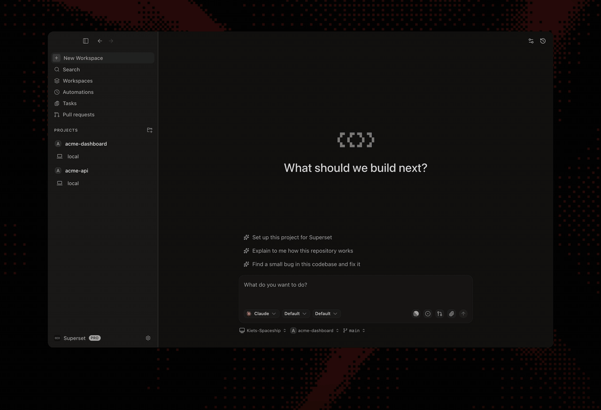
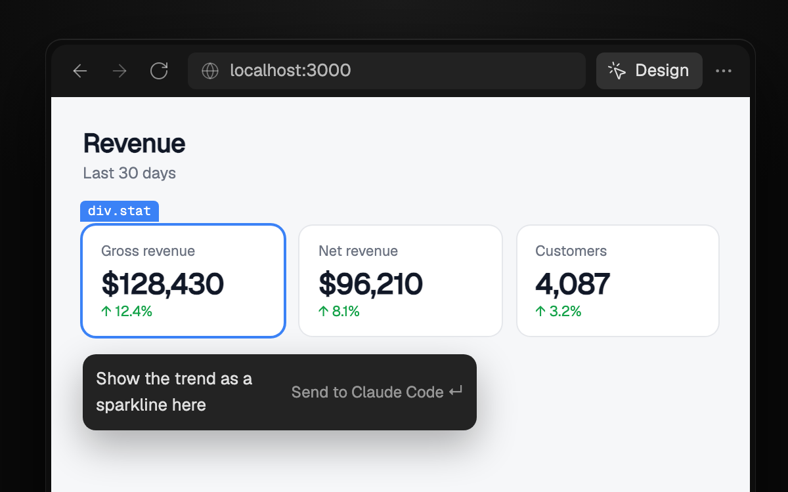

<div align="center">



### Execute mais de 100 agentes de código em paralelo

<details>
<summary>🌐 Ler em outros idiomas</summary>
<br />

[English](../README.md) | [日本語](README.ja.md) | [简体中文](README.zh-CN.md) | [繁體中文](README.zh-TW.md) | [한국어](README.ko.md) | [Français](README.fr.md) | [Español](README.es.md) | [Deutsch](README.de.md) | [Português](README.pt-BR.md) | [Italiano](README.it.md) | [Русский](README.ru.md) | [Türkçe](README.tr.md) | [Polski](README.pl.md) | [Nederlands](README.nl.md) | [Bahasa Indonesia](README.id.md) | [Čeština](README.cs.md) | [Tiếng Việt](README.vi.md)

</details>

*Esta é uma tradução do [README em inglês](../README.md), que é a versão canônica.*

[](https://github.com/paradevai/paradev/stargazers)
[](https://github.com/paradevai/paradev/releases)
[](../LICENSE.md)
[](https://x.com/paradevai)
[](https://discord.gg/cZeD9WYcV7)

<br />

Claude Code, Codex ou qualquer agente de CLI, cada um em seu próprio worktree isolado.<br />
Passe seu tempo entregando, não esperando.

<br />

[**Baixar para macOS**](https://github.com/paradevai/paradev/releases/latest) &nbsp;&bull;&nbsp; [Documentação](https://docs.paradev.com) &nbsp;&bull;&nbsp; [Changelog](https://github.com/paradevai/paradev/releases) &nbsp;&bull;&nbsp; [Discord](https://discord.gg/cZeD9WYcV7)

<br />


</div>

## Programe 10x mais rápido sem custo de troca de contexto

O Paradev executa agentes de código baseados em CLI em paralelo em worktrees git isolados, em um terminal ou como um chat, com terminal, revisão e fluxos de abrir no editor integrados.

- **Execute vários agentes ao mesmo tempo** sem a sobrecarga da troca de contexto
- **Isole cada tarefa** em seu próprio worktree git para que os agentes não interfiram uns nos outros
- **Monitore todos os seus agentes** de um só lugar e seja notificado quando precisarem de atenção
- **Revise e edite mudanças rapidamente** com o visualizador de diff e o editor integrados
- **Abra qualquer área de trabalho onde você precisar** com passagem em um clique para o seu editor ou terminal
- **Acesse suas áreas de trabalho de qualquer lugar** via hosts remotos, CLI, SDK ou MCP

Espere menos, entregue mais.

## Recursos

<table>
<tr>
<td width="50%" valign="middle">

### Áreas de trabalho paralelas

Execute mais de 100 agentes de código de uma vez, cada um em seu próprio worktree git com sua própria branch, terminal e ambiente. Compare os resultados e faça merge do vencedor.

[Docs →](https://docs.paradev.com/workspaces)

</td>
<td width="50%">
  <a href="https://docs.paradev.com/workspaces"></a>
</td>
</tr>
<tr>
<td width="50%" valign="middle">

### Monitoramento de agentes

Acompanhe cada agente pela barra lateral, com indicadores de atividade, sons de conclusão e badges no dock quando algum precisar da sua atenção.

[Docs →](https://docs.paradev.com/agent-integration)

</td>
<td width="50%">
  <a href="https://docs.paradev.com/agent-integration"></a>
</td>
</tr>
<tr>
<td width="50%" valign="middle">

### Terminal integrado

Abas, divisões infinitas, presets e sessões persistentes que sobrevivem a reinicializações. Pressione ⌘I para um editor de prompt avançado com edição em várias linhas e menções de arquivos com @.

[Docs →](https://docs.paradev.com/terminal-integration)

</td>
<td width="50%">
  <a href="https://docs.paradev.com/terminal-integration"></a>
</td>
</tr>
<tr>
<td width="50%" valign="middle">

### Visualizador de diff integrado

Inspecione, comente e edite as mudanças dos agentes sem sair do app, e depois faça commit e push quando estiver pronto.

[Docs →](https://docs.paradev.com/diff-viewer)

</td>
<td width="50%">
  <a href="https://docs.paradev.com/diff-viewer"></a>
</td>
</tr>
<tr>
<td width="50%" valign="middle">

### Navegador integrado e portas

Visualize servidores de dev em execução em um painel de navegador. As portas são detectadas por área de trabalho, então cada worktree tem sua própria prévia.

[Docs →](https://docs.paradev.com/browser)

</td>
<td width="50%">
  <a href="https://docs.paradev.com/browser"></a>
</td>
</tr>
<tr>
<td width="50%" valign="middle">

### Automações

Execute sessões de agentes de forma agendada: faça triagem de issues durante a noite, redija o changelog semanal, mantenha as dependências em dia.

[Docs →](https://docs.paradev.com/automations)

</td>
<td width="50%">
  <a href="https://docs.paradev.com/automations"></a>
</td>
</tr>
<tr>
<td width="50%" valign="middle">

### Acesso remoto

Conecte outra máquina e acesse as áreas de trabalho dela de qualquer lugar: pelo app desktop, pela CLI ou pelo celular. Acorde hosts offline com um comando personalizado.

[Docs →](https://docs.paradev.com/remote-access)

</td>
<td width="50%">
  <a href="https://docs.paradev.com/remote-access"></a>
</td>
</tr>
<tr>
<td width="50%" valign="middle">

### CLI do Paradev

Automatize de qualquer shell: crie áreas de trabalho, inicie agentes, leia seus terminais e gerencie automações com um único binário. Se um agente consegue executar um comando, ele consegue controlar o Paradev.

[Docs →](https://docs.paradev.com/cli/getting-started)

</td>
<td width="50%">
  <a href="https://docs.paradev.com/cli/getting-started"></a>
</td>
</tr>
<tr>
<td width="50%" valign="middle">

### Paleta de comandos

Vá para qualquer área de trabalho, ação ou configuração a partir de uma única caixa de busca.

[Docs →](https://docs.paradev.com/keyboard-shortcuts)

</td>
<td width="50%">
  <a href="https://docs.paradev.com/keyboard-shortcuts"></a>
</td>
</tr>
</table>

**Também na caixa:**

- **[Habilidades integradas](https://docs.paradev.com/skills)**: os agentes já vêm carregados com as habilidades `superset:*` (orquestrar agentes em paralelo, agendar automações, enviar feedback, diagnosticar problemas), provisionadas automaticamente na inicialização
- **[Seletor de modelo e agentes personalizados](https://docs.paradev.com/agent-integration)**: escolha um modelo e o nível de raciocínio na inicialização, e adicione qualquer agente de terminal com seu próprio ícone
- **[Scripts de configuração de área de trabalho](https://docs.paradev.com/setup-teardown-scripts)**: automatize a configuração do ambiente, a instalação de dependências e os servidores de dev por área de trabalho
- **[Presets de terminal](https://docs.paradev.com/terminal-presets)**: salve layouts de agentes e shells e abra-os com uma única tecla
- **[Slack e Linear](https://docs.paradev.com/use-with-linear)**: crie áreas de trabalho a partir de mensagens do Slack ou issues do Linear
- **[Abrir na sua IDE](https://docs.paradev.com/use-with-ide)**: passagem em um clique para o Cursor, o VS Code ou qualquer editor
- **[Temas personalizados](https://docs.paradev.com/custom-themes)**: crie, edite e importe arquivos de tema
- **[Atalhos de teclado](https://docs.paradev.com/keyboard-shortcuts)**: toda ação pode ser remapeada em **Configurações → Atalhos de teclado** (⌘/)
- **[Traga seus próprios provedores](https://docs.paradev.com/providers)**: conecte OpenRouter, Bedrock, Vertex ou Vercel AI Gateway
- **E muito mais**: lançamos todo dia, então esta lista está perpetuamente atrasada. O [changelog](https://paradev.com/changelog) é a verdadeira lista de recursos.

## Agentes compatíveis

O Paradev funciona com qualquer agente de código baseado em CLI, incluindo:

| Agente | Status |
|:------|:-------|
|  &nbsp;[Amp Code](https://ampcode.com/) | Totalmente compatível |
|  &nbsp;[Antigravity CLI](https://antigravity.google/) | Totalmente compatível |
|  &nbsp;[Claude Code](https://github.com/anthropics/claude-code) | Totalmente compatível |
| <picture><source media="(prefers-color-scheme: dark)" srcset="../packages/ui/src/assets/icons/preset-icons/codex-white.svg" /></picture> &nbsp;[OpenAI Codex CLI](https://github.com/openai/codex) | Totalmente compatível |
|  &nbsp;[Cursor Agent](https://docs.cursor.com/agent) | Totalmente compatível |
| <picture><source media="(prefers-color-scheme: dark)" srcset="../packages/ui/src/assets/icons/preset-icons/droid-white.svg" /></picture> &nbsp;[Droid](https://www.factory.ai/) | Totalmente compatível |
| <picture><source media="(prefers-color-scheme: dark)" srcset="../packages/ui/src/assets/icons/preset-icons/fx-white.svg" /></picture> &nbsp;[fx](https://fx.sh/) | Totalmente compatível |
|  &nbsp;[Gemini CLI](https://github.com/google-gemini/gemini-cli) | Totalmente compatível |
| <picture><source media="(prefers-color-scheme: dark)" srcset="../packages/ui/src/assets/icons/preset-icons/copilot-white.svg" /></picture> &nbsp;[GitHub Copilot](https://github.com/features/copilot) | Totalmente compatível |
| <picture><source media="(prefers-color-scheme: dark)" srcset="../packages/ui/src/assets/icons/preset-icons/grok-white.svg" /></picture> &nbsp;[Grok](https://x.ai/) | Totalmente compatível |
| <picture><source media="(prefers-color-scheme: dark)" srcset="../packages/ui/src/assets/icons/preset-icons/hermes-white.svg" /></picture> &nbsp;[Hermes](https://github.com/NousResearch/hermes-agent) | Totalmente compatível |
| <picture><source media="(prefers-color-scheme: dark)" srcset="../packages/ui/src/assets/icons/preset-icons/muse-white.svg" /></picture> &nbsp;[Muse Code](https://developer.meta.com/ai/products/muse-code/) | Totalmente compatível |
| <picture><source media="(prefers-color-scheme: dark)" srcset="../packages/ui/src/assets/icons/preset-icons/devin-white.svg" /></picture> &nbsp;[Devin](https://devin.ai/cli) | Totalmente compatível |
| <picture><source media="(prefers-color-scheme: dark)" srcset="../packages/ui/src/assets/icons/preset-icons/kimi-white.svg" /></picture> &nbsp;[Kimi Code](https://www.kimi.com/) | Totalmente compatível |
|  &nbsp;[Kiro](https://kiro.dev/cli/) | Totalmente compatível |
| <picture><source media="(prefers-color-scheme: dark)" srcset="../packages/ui/src/assets/icons/preset-icons/mastracode-white.svg" /></picture> &nbsp;[Mastra Code](https://mastra.ai/) | Totalmente compatível |
|  &nbsp;[Mistral Vibe](https://mistral.ai/) | Totalmente compatível |
| <picture><source media="(prefers-color-scheme: dark)" srcset="../packages/ui/src/assets/icons/preset-icons/pi-white.svg" /></picture> &nbsp;[Oh My Pi](https://github.com/can1357/oh-my-pi) | Totalmente compatível |
| <picture><source media="(prefers-color-scheme: dark)" srcset="../packages/ui/src/assets/icons/preset-icons/opencode-white.svg" /></picture> &nbsp;[OpenCode](https://github.com/opencode-ai/opencode) | Totalmente compatível |
| <picture><source media="(prefers-color-scheme: dark)" srcset="../packages/ui/src/assets/icons/preset-icons/pi-white.svg" /></picture> &nbsp;[Pi](https://github.com/badlogic/pi-mono/tree/main/packages/coding-agent) | Totalmente compatível |
| <picture><source media="(prefers-color-scheme: dark)" srcset="../packages/ui/src/assets/icons/preset-icons/polygraph-white.svg" /></picture> &nbsp;[Polygraph](https://trypolygraph.com/) | Totalmente compatível |
| Qualquer outro agente de CLI | Funciona sem configuração |

Se roda em um terminal, roda no Paradev

Os agentes recebem mais do que um terminal:

- **Seletor de modelo**: escolha um modelo e o nível de raciocínio ao iniciar um agente
- **Configurações por agente**: ajuste comandos de inicialização, templates de prompt e substituições de modelo em Configurações → Agentes
- **Agentes personalizados**: adicione qualquer agente de terminal com seu próprio ícone e ele funciona como um integrado
- **Status e notificações**: indicadores de atividade, sons de conclusão e badges no dock quando um agente precisar de você
- **Chat integrado**: converse com os modelos em um painel de chat, com aprovações de ferramentas inline e revisão de planos

<details>
<summary><strong>Perguntas frequentes</strong></summary>
<br />

<details>
<summary>O Paradev é um app de terminal ou um app desktop?</summary>
<br />

O Paradev é um app desktop, não um app de terminal. Os agentes rodam dentro dele como um chat ou em um terminal. Ao lado deles você tem um visualizador de diff, pull requests, um navegador integrado e um editor de arquivos. [Documentação de FAQ](https://docs.paradev.com/faq)

</details>

<details>
<summary>Preciso usar um terminal ou posso conversar com o agente de código por chat?</summary>
<br />

Não, o Paradev pode mostrar uma sessão de agente como um chat em vez de um terminal, e você aprova ou recusa as ações do agente com um clique. O chat funciona com Claude Code, Codex, OpenCode e Pi; o Paradev executa a CLI que você já instalou, então mantém seu login e suas configurações. O seletor **CLI** / **Chat** alterna uma sessão em execução sem perder o contexto, e os outros agentes rodam em um terminal do Paradev. [Documentação do chat](https://docs.paradev.com/chat)

</details>

<details>
<summary>Qual é a licença do Paradev, quanto custa e em quais plataformas ele roda?</summary>
<br />

O Paradev é open source sob a Licença MIT. O plano Free cobre áreas de trabalho locais com o app desktop e a CLI. Os planos pagos adicionam recursos como automações e áreas de trabalho na nuvem. O app desktop roda no macOS e no Linux; o Windows ainda não está disponível. [Preços](https://paradev.com/pricing) · [Documentação de FAQ](https://docs.paradev.com/faq)

</details>

<details>
<summary>O Paradev é o mesmo que o Superset? Tem relação com o Apache Superset?</summary>
<br />

O Paradev se chamava Superset, e é por isso que o comando da CLI ainda é `superset`. Ele não tem relação com o Apache Superset, a ferramenta de business intelligence. [Documentação de instalação](https://docs.paradev.com/install)

</details>

<details>
<summary>Quais agentes de código o Paradev suporta, e eu continuo usando minhas próprias assinaturas?</summary>
<br />

O Paradev tem suporte integrado para Claude Code, Codex, OpenCode, Cursor Agent, Gemini CLI, Amp e outros, e você pode adicionar qualquer outro agente de CLI. Claude Code, Codex, OpenCode e Pi também podem rodar como um chat. Os agentes usam suas próprias assinaturas e chaves de API, e o Paradev não faz proxy das chamadas aos modelos. [Documentação de agentes suportados](https://docs.paradev.com/supported-agents)

</details>

<details>
<summary>Como evito que vários agentes de código sobrescrevam o trabalho uns dos outros em um mesmo repositório?</summary>
<br />

O Paradev dá a cada agente sua própria área de trabalho: um worktree Git em sua própria branch, com seu próprio terminal. Os agentes editam cópias separadas dos arquivos de trabalho, então um agente não sobrescreve as mudanças de outro. Worktrees não isolam processos em sandbox, e as branches ainda podem entrar em conflito quando você faz o merge delas. [Documentação de áreas de trabalho](https://docs.paradev.com/workspaces)

</details>

<details>
<summary>Tenho sessões de terminal do Claude Code demais. Como acompanho todas elas?</summary>
<br />

O Paradev mostra todas as sessões de agente em uma única barra lateral, agrupadas por projeto, com um status para cada uma, seja a sessão rodando como chat ou em um terminal. O Claude Code avisa quando termina e quando espera sua resposta, e a barra lateral destaca as áreas de trabalho que precisam de você. [Documentação de status dos agentes](https://docs.paradev.com/agent-status)

</details>

<details>
<summary>Posso rodar dois agentes de código na mesma tarefa e comparar os resultados?</summary>
<br />

Sim, no Paradev você dá o mesmo prompt a duas ou mais áreas de trabalho, cada uma em sua própria branch, com o mesmo agente ou agentes diferentes. Depois você compara os diffs e fica com o melhor resultado. [Receita para competir agentes](https://docs.paradev.com/recipes/race-agents)

</details>

<details>
<summary>Posso usar Claude Code e Codex juntos, um escrevendo código e o outro revisando?</summary>
<br />

Sim, o Paradev roda Claude Code e Codex lado a lado, cada um como chat ou em um terminal. Para pedir uma revisão, selecione linhas na aba **Code** de um pull request e envie-as para o outro agente, ou use **Continue with another agent** para iniciar uma sessão de outro agente com o contexto recente. [Documentação de sessões de agente](https://docs.paradev.com/agent-sessions)

</details>

<details>
<summary>Como reviso o diff de um agente de código e envio ajustes antes de fazer o merge?</summary>
<br />

O Paradev mostra as mudanças de cada área de trabalho em um visualizador de diff, onde você faz commit, push e abre um pull request. Na aba **Code** do pull request, selecione linhas e envie um comentário para um agente em execução ou para uma nova sessão; publicá-lo no GitHub é opcional. Você pode acompanhar os checks e fazer o merge na mesma tela. [Documentação de pull requests](https://docs.paradev.com/pull-requests)

</details>

<details>
<summary>Como mantenho separados o servidor de dev, as portas e a prévia de cada branch?</summary>
<br />

O Paradev mantém cada branch em seu próprio worktree e mostra as portas em que os processos de cada área de trabalho estão escutando, agrupadas por área de trabalho. Selecione uma porta para abrir o servidor de dev daquela branch no navegador integrado. O Paradev não atribui faixas de portas, então defina a configuração por área de trabalho em um script de setup, que roda em cada nova área de trabalho com variáveis como `SUPERSET_WORKSPACE_PATH`. [Documentação de portas](https://docs.paradev.com/ports)

</details>

<details>
<summary>Posso clicar em um elemento do meu app web em execução e fazer um agente de código alterá-lo?</summary>
<br />

Sim, o Paradev tem um modo Design no navegador integrado: abra seu servidor de dev, ative **Design** e clique no elemento. Depois você descreve a mudança, e o agente recebe os detalhes do elemento e uma captura de tela com a sua anotação. [Documentação do navegador](https://docs.paradev.com/browser)

</details>

<details>
<summary>Posso ser notificado quando um agente de código precisar da minha resposta?</summary>
<br />

Sim, o app desktop do Paradev avisa quando um agente termina ou para para esperar sua resposta, e o ícone no dock do macOS mostra um badge. O suporte varia por agente: o Claude Code informa os dois estados, e alguns agentes só avisam quando terminam. No app mobile, um ponto na área de trabalho indica que um agente precisa da sua permissão; notificações push ainda não estão disponíveis. [Documentação de status dos agentes](https://docs.paradev.com/agent-status)

</details>

<details>
<summary>Posso acompanhar meus agentes de código e responder a eles pelo iPhone?</summary>
<br />

Sim, o Paradev para iPhone e iPad permite iniciar agentes, acompanhar as sessões ao vivo, responder a eles e revisar as mudanças. Ele exige iOS 26 ou iPadOS 26 ou posterior e o Paradev Pro, e também há um app Android no Google Play. Para áreas de trabalho no seu computador, ative o Acesso remoto e mantenha o computador ligado e online. [Documentação do app mobile](https://docs.paradev.com/mobile)

</details>

<details>
<summary>Um agente de código pode rodar em um agendamento, como uma manutenção noturna ou uma checagem semanal de testes instáveis?</summary>
<br />

Sim, as automações do Paradev executam um agente em um agendamento por hora, diário, semanal ou personalizado. Cada execução cria uma área de trabalho onde você revisa as mudanças e continua o trabalho. As automações exigem o plano Pro. [Documentação de automações](https://docs.paradev.com/automations)

</details>

<details>
<summary>Posso iniciar um agente de código pelo Slack, Linear, Sentry ou por um pull request no GitHub?</summary>
<br />

Sim, as automações do Paradev iniciam um agente quando chega um evento de pull request do GitHub, uma mensagem do Slack, uma issue do Linear, uma issue do Sentry ou um webhook, e o agente recebe os detalhes do evento junto com o seu prompt. Você também pode mencionar o bot do Paradev no Slack para iniciar uma área de trabalho na nuvem e um agente. As automações e a integração com o Slack exigem o plano Pro. [Documentação de automações](https://docs.paradev.com/automations)

</details>

<details>
<summary>Posso iniciar agentes de código pela linha de comando ou a partir de outro agente?</summary>
<br />

Sim, a CLI do Paradev cria áreas de trabalho e inicia agentes nelas a partir de um script de shell ou de outro agente. Os agentes também podem usar o servidor MCP do Paradev para trabalhar com áreas de trabalho e terminais. O app desktop inclui uma skill de orquestração que permite a um agente coordenar outros agentes em áreas de trabalho separadas. [Documentação da CLI](https://docs.paradev.com/cli/getting-started)

</details>

<details>
<summary>Posso rodar agentes de código em uma máquina remota ou na nuvem e revisar as mudanças pelo meu laptop?</summary>
<br />

Sim, com o acesso remoto do Paradev (plano Pro) você abre pelo seu laptop áreas de trabalho hospedadas em outra máquina, como um Mac mini ou um servidor. As áreas de trabalho na nuvem (planos Team e Ultra) rodam cada área de trabalho em sua própria máquina na nuvem, então os agentes continuam trabalhando com o laptop fechado. [Documentação de acesso remoto](https://docs.paradev.com/remote-access)

</details>

<details>
<summary>Posso voltar a uma tarefa depois e encontrar a sessão do agente e a branch ainda lá?</summary>
<br />

Sim, uma área de trabalho do Paradev fica no disco como um worktree Git em sua branch até você excluí-la. Os terminais pertencem a um processo em segundo plano, então continuam rodando e mantêm o histórico de rolagem quando você fecha ou atualiza o app. Se um terminal parar depois de um travamento ou reinício, o Paradev pode retomar a sessão do agente para agentes que suportam retomada, como Claude Code e Codex. [Documentação para manter agentes rodando](https://docs.paradev.com/keep-agents-running)

</details>

<details>
<summary>Uma equipe pequena pode compartilhar uma máquina para agentes de código?</summary>
<br />

Sim, um host do Paradev pode ser uma máquina compartilhada, como um Mac mini, que os colegas acessam via acesso remoto (plano Pro). Quando o host fica online pela primeira vez, só a pessoa que o iniciou tem acesso. Essa pessoa adiciona os colegas em **Settings → Hosts**. [Documentação de acesso remoto](https://docs.paradev.com/remote-access)

</details>

<details>
<summary>Qual é a diferença entre o Paradev e o Conductor, o Orca e o Cursor?</summary>
<br />

Paradev, Conductor e Orca rodam agentes de código em worktrees Git paralelos, e o Cursor é um editor com IA construído em torno do seu próprio agente. O Paradev roda qualquer agente de CLI com as suas próprias assinaturas e abre uma área de trabalho no Cursor quando você quer editar lá. O Orca também é open source e roda no Windows, que o Paradev ainda não suporta. O Conductor está se juntando à Meta e está fechado para novos usuários, e o Paradev tem um guia para migrar as áreas de trabalho do Conductor. [Migrar do Conductor](https://docs.paradev.com/migrate-from-conductor)

</details>

<details>
<summary>O Paradev substitui o tmux?</summary>
<br />

Sim, para rodar agentes de código o Paradev pode substituir o tmux: as sessões de terminal dele continuam rodando quando você fecha, encerra ou atualiza o app. Cada área de trabalho também ganha seu próprio worktree e status na barra lateral. Você ainda pode rodar o tmux dentro de um terminal do Paradev. [Documentação para manter agentes rodando](https://docs.paradev.com/keep-agents-running)

</details>

</details>

## Mais do que um app desktop

Todas as superfícies conversam com as mesmas áreas de trabalho, então você pode começar uma tarefa no app e acompanhá-la de qualquer lugar.

| Superfície | O que você ganha |
|:--------|:-------------|
| [**App desktop**](https://github.com/paradevai/paradev/releases/latest) | A IDE completa: terminais, visualizador de diff, navegador integrado, automações |
| [**CLI**](https://docs.paradev.com/cli/getting-started) | Um único binário `superset` para gerenciar áreas de trabalho, agentes, terminais e hosts de qualquer shell |
| [**SDK TypeScript**](https://docs.paradev.com/sdk/getting-started) | Controle o Paradev programaticamente com [`@superset_sh/sdk`](https://www.npmjs.com/package/@superset_sh/sdk) a partir de Node, Bun ou Deno |
| [**Servidor MCP**](https://docs.paradev.com/mcp) | Deixe o Claude Code, o Codex, o Cursor e outros agentes criarem e gerenciarem áreas de trabalho por conta própria |

A CLI vem junto com o app desktop, ou instale-a separadamente:

```bash
curl -fsSL https://paradev.com/cli/install.sh | sh
# or
brew install paradevai/tap/superset
```

Um app para iOS chega em breve para você acompanhar seus agentes pelo celular.

## Instalação

Baixe o app desktop:

- **macOS**: [Apple Silicon (.dmg)](https://github.com/paradevai/paradev/releases/latest/download/Superset-arm64.dmg) · [Intel (.dmg)](https://github.com/paradevai/paradev/releases/latest/download/Superset-x64.dmg)
- **Linux**: [AppImage x64](https://github.com/paradevai/paradev/releases/latest/download/Paradev-x86_64.AppImage)
- **Windows**: ainda não disponível
- [Todas as builds](https://github.com/paradevai/paradev/releases/latest)

Tudo o que você precisa ter instalado é o [Git](https://git-scm.com/). O [gh](https://cli.github.com/) é opcional e desbloqueia os fluxos de PR; o Paradev se oferece para instalá-lo para você.

## Desenvolvimento

Quer mexer no Paradev ou contribuir com uma PR? Clone o repositório, adicione-o ao
app do Paradev instalado e crie uma área de trabalho para a sua mudança:

```bash
git clone https://github.com/paradevai/paradev.git
```

Depois execute a configuração de desenvolvimento no terminal dessa área de trabalho:

```bash
./.paradev/setup.local.sh
bun run dev
```

Execute `setup.local.sh` uma vez em cada worktree novo. Ele configura a identidade
do app e as portas específicas da área de trabalho para que o app desktop de desenvolvimento
possa rodar ao lado do app do Paradev instalado e de outros worktrees de desenvolvimento.

Não é preciso conta na Neon nem credenciais de terceiros. O `setup.local.sh` sobe
uma stack local de Postgres + Electric via Docker e cria uma conta de dev. Entre
com o botão **"Sign in as dev"** (ou `admin@local.test` / `supersetdev`).

Pré-requisitos: [Bun](https://bun.sh/) v1.4.3+ (fixado em `.bun-version`), `docker`, `jq` e `caddy`, que o `bun dev` executa como proxy HTTPS local (`brew install jq caddy && caddy trust`).

Veja [**DEVELOPMENT.md**](../DEVELOPMENT.md) para o guia completo: o que o script de configuração faz, configuração manual com serviços reais, comandos comuns, solução de problemas e como compilar o app desktop. O processo de contribuição está em [**CONTRIBUTING.md**](../CONTRIBUTING.md).

## Configuração

Configure os scripts de setup, teardown e run das áreas de trabalho em `.paradev/config.json`. Veja a [documentação completa](https://docs.paradev.com/setup-teardown-scripts).

```json
{
  "setup": ["./.paradev/setup.sh"],
  "teardown": ["./.paradev/teardown.sh"],
  "run": ["./.paradev/run.sh"]
}
```

Os atalhos de teclado são personalizáveis em **Configurações → Atalhos de teclado** (⌘/); veja a [lista completa de atalhos](https://docs.paradev.com/keyboard-shortcuts).

## Stack de tecnologia

<p>
  <a href="https://www.electronjs.org/"></a>
  <a href="https://reactjs.org/"></a>
  <a href="https://tailwindcss.com/"></a>
  <a href="https://bun.sh/"></a>
  <a href="https://turbo.build/"></a>
  <a href="https://vitejs.dev/"></a>
  <a href="https://biomejs.dev/"></a>
  <a href="https://orm.drizzle.team/"></a>
  <a href="https://neon.tech/"></a>
  <a href="https://trpc.io/"></a>
</p>

## Privado por padrão

- **Conexões explícitas**: você escolhe quais agentes, provedores e integrações conectar.

## Contribuindo

Contribuições são bem-vindas! Veja [CONTRIBUTING.md](../CONTRIBUTING.md) para saber como se preparar e abrir uma PR. Bugs e pedidos de recursos vão nas [issues](https://github.com/paradevai/paradev/issues).

<a href="https://github.com/paradevai/paradev/graphs/contributors">
  
</a>

## Comunidade

Junte-se à comunidade do Paradev para obter ajuda, compartilhar feedback e se conectar com outros usuários:

- **[Discord](https://discord.gg/cZeD9WYcV7)**: converse com o time e a comunidade
- **[Twitter](https://x.com/paradevai)**: siga para novidades e anúncios
- **[GitHub Issues](https://github.com/paradevai/paradev/issues)**: relate bugs e peça recursos
- **[GitHub Discussions](https://github.com/paradevai/paradev/discussions)**: faça perguntas e compartilhe ideias

### Time

[](https://x.com/avimakesrobots)
[](https://x.com/flyakiet)
[](https://x.com/saddle_paddle)

## Licença e o que é grátis para sempre

**O app desktop é grátis para sempre.** Executar agentes em paralelo na sua própria máquina nunca exigirá pagamento. Qualquer coisa que cobrarmos será um serviço opcional por cima.

O app inteiro está neste repositório sob a [Licença MIT](../LICENSE.md): use, faça fork, modifique, hospede você mesmo e redistribua.
