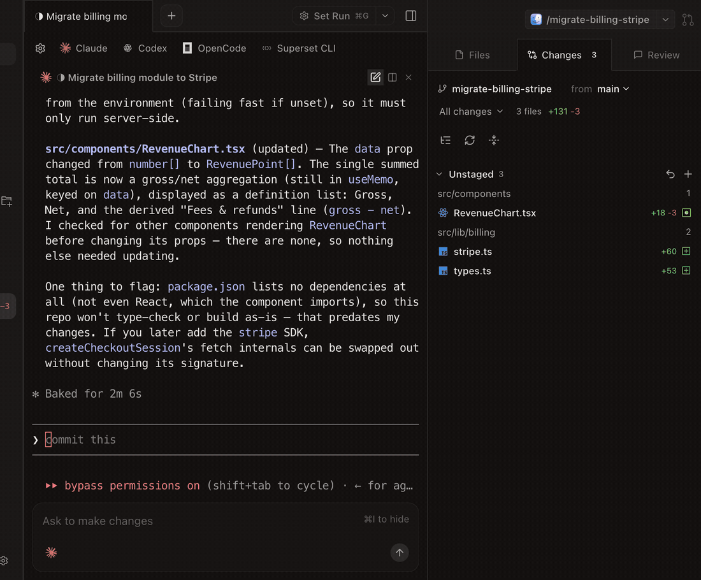
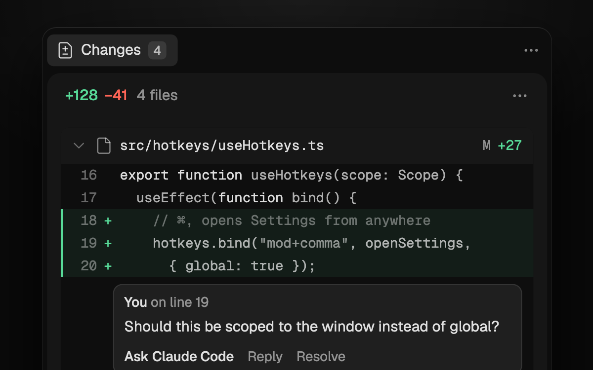

<div align="center">


### Запускайте 100+ агентов для кодинга параллельно

<details>
<summary>🌐 Читать на других языках</summary>
<br />

[English](../README.md) | [日本語](README.ja.md) | [简体中文](README.zh-CN.md) | [繁體中文](README.zh-TW.md) | [한국어](README.ko.md) | [Français](README.fr.md) | [Español](README.es.md) | [Deutsch](README.de.md) | [Português](README.pt-BR.md) | [Italiano](README.it.md) | [Русский](README.ru.md) | [Türkçe](README.tr.md) | [Polski](README.pl.md) | [Nederlands](README.nl.md) | [Bahasa Indonesia](README.id.md) | [Čeština](README.cs.md) | [Tiếng Việt](README.vi.md)

</details>

*Перевод английского README; канонической является английская версия.*

[](https://github.com/paradevai/paradev/stargazers)
[](https://github.com/paradevai/paradev/releases)
[](../LICENSE.md)
[](https://x.com/paradevai)
[](https://discord.gg/cZeD9WYcV7)

<br />

Claude Code, Codex или любой CLI-агент — каждый в своём изолированном worktree.<br />
Тратьте время на выпуск фич, а не на ожидание.

<br />

[**Скачать для macOS**](https://github.com/paradevai/paradev/releases/latest) &nbsp;&bull;&nbsp; [Документация](https://docs.paradev.com) &nbsp;&bull;&nbsp; [Changelog](https://github.com/paradevai/paradev/releases) &nbsp;&bull;&nbsp; [Discord](https://discord.gg/cZeD9WYcV7)

<br />


</div>

## Пишите код в 10 раз быстрее без затрат на переключение

Paradev запускает CLI-агентов для кодинга параллельно в изолированных git worktree — в терминале или в виде чата — со встроенным терминалом, ревью изменений и открытием в редакторе.

- **Запускайте несколько агентов одновременно** без накладных расходов на переключение контекста
- **Изолируйте каждую задачу** в отдельном git worktree, чтобы агенты не мешали друг другу
- **Следите за всеми агентами** из одного места и получайте уведомления, когда им нужно внимание
- **Быстро проверяйте и правьте изменения** во встроенном просмотрщике diff и редакторе
- **Открывайте любую рабочую область там, где нужно** — передача в редактор или терминал в один клик
- **Подключайтесь к рабочим областям откуда угодно** через удалённые хосты, CLI, SDK или MCP

Меньше ожидания — больше релизов.

## Возможности

<table>
<tr>
<td width="50%" valign="middle">

### Параллельные рабочие области

Запускайте 100+ агентов для кодинга одновременно — каждый в собственном git worktree со своей веткой, терминалом и окружением. Сравните результаты и смержите лучший.

[Документация →](https://docs.paradev.com/workspaces)

</td>
<td width="50%">
  <a href="https://docs.paradev.com/workspaces"></a>
</td>
</tr>
<tr>
<td width="50%" valign="middle">

### Мониторинг агентов

Отслеживайте каждого агента из боковой панели: индикаторы работы, звуковые сигналы о завершении и бейджи в доке, когда агенту нужно ваше внимание.

[Документация →](https://docs.paradev.com/agent-integration)

</td>
<td width="50%">
  <a href="https://docs.paradev.com/agent-integration"></a>
</td>
</tr>
<tr>
<td width="50%" valign="middle">

### Встроенный терминал

Вкладки, бесконечные сплиты, пресеты и постоянные сессии, переживающие перезапуски. Нажмите ⌘I — откроется расширенный редактор промптов с многострочным вводом и упоминаниями файлов через @.

[Документация →](https://docs.paradev.com/terminal-integration)

</td>
<td width="50%">
  <a href="https://docs.paradev.com/terminal-integration"></a>
</td>
</tr>
<tr>
<td width="50%" valign="middle">

### Встроенный просмотрщик diff

Изучайте, комментируйте и правьте изменения агентов, не выходя из приложения, а затем делайте commit и push, когда всё готово.

[Документация →](https://docs.paradev.com/diff-viewer)

</td>
<td width="50%">
  <a href="https://docs.paradev.com/diff-viewer"></a>
</td>
</tr>
<tr>
<td width="50%" valign="middle">

### Встроенный браузер и порты

Просматривайте запущенные dev-серверы в панели браузера. Порты определяются для каждой рабочей области, так что у каждого worktree — своё превью.

[Документация →](https://docs.paradev.com/browser)

</td>
<td width="50%">
  <a href="https://docs.paradev.com/browser"></a>
</td>
</tr>
<tr>
<td width="50%" valign="middle">

### Автоматизации

Запускайте сессии агентов по расписанию: разбирайте issue за ночь, готовьте черновик еженедельного changelog, держите зависимости свежими.

[Документация →](https://docs.paradev.com/automations)

</td>
<td width="50%">
  <a href="https://docs.paradev.com/automations"></a>
</td>
</tr>
<tr>
<td width="50%" valign="middle">

### Удалённый доступ

Подключите другую машину и работайте с её рабочими областями откуда угодно: из десктопного приложения, CLI или с телефона. Будите офлайн-хосты пользовательской командой.

[Документация →](https://docs.paradev.com/remote-access)

</td>
<td width="50%">
  <a href="https://docs.paradev.com/remote-access"></a>
</td>
</tr>
<tr>
<td width="50%" valign="middle">

### Paradev CLI

Скриптуйте из любой оболочки: создавайте рабочие области, запускайте агентов, читайте их терминалы и управляйте автоматизациями одним бинарником. Если агент умеет выполнять команды, он умеет управлять Paradev.

[Документация →](https://docs.paradev.com/cli/getting-started)

</td>
<td width="50%">
  <a href="https://docs.paradev.com/cli/getting-started"></a>
</td>
</tr>
<tr>
<td width="50%" valign="middle">

### Палитра команд

Переходите к любой рабочей области, действию или настройке из одной строки поиска.

[Документация →](https://docs.paradev.com/keyboard-shortcuts)

</td>
<td width="50%">
  <a href="https://docs.paradev.com/keyboard-shortcuts"></a>
</td>
</tr>
</table>

**Также в комплекте:**

- **[Встроенные навыки](https://docs.paradev.com/skills)**: агенты поставляются с предустановленными навыками `superset:*` (оркестрация параллельных агентов, планирование автоматизаций, отправка отзывов, диагностика проблем), которые устанавливаются автоматически при запуске
- **[Выбор модели и пользовательские агенты](https://docs.paradev.com/agent-integration)**: выбирайте модель и уровень рассуждений при запуске и добавляйте любого терминального агента с собственной иконкой
- **[Скрипты настройки рабочей области](https://docs.paradev.com/setup-teardown-scripts)**: автоматизируйте настройку окружения, установку зависимостей и dev-серверы для каждой рабочей области
- **[Пресеты терминала](https://docs.paradev.com/terminal-presets)**: сохраняйте раскладки агентов и оболочек и открывайте их одним нажатием
- **[Slack и Linear](https://docs.paradev.com/use-with-linear)**: создавайте рабочие области из сообщений Slack или задач Linear
- **[Открытие в вашей IDE](https://docs.paradev.com/use-with-ide)**: передача в Cursor, VS Code или любой редактор в один клик
- **[Пользовательские темы](https://docs.paradev.com/custom-themes)**: создавайте, редактируйте и импортируйте файлы тем
- **[Горячие клавиши](https://docs.paradev.com/keyboard-shortcuts)**: любое действие можно переназначить в **Настройки → Горячие клавиши** (⌘/)
- **[Свои провайдеры](https://docs.paradev.com/providers)**: подключайте OpenRouter, Bedrock, Vertex или Vercel AI Gateway
- **И многое другое**: мы выпускаем обновления каждый день, так что этот список вечно отстаёт. Настоящий список возможностей — [changelog](https://paradev.com/changelog).

## Поддерживаемые агенты

Paradev работает с любым CLI-агентом для кодинга, в том числе:

| Агент | Статус |
|:------|:-------|
|  &nbsp;[Amp Code](https://ampcode.com/) | Полная поддержка |
|  &nbsp;[Antigravity CLI](https://antigravity.google/) | Полная поддержка |
|  &nbsp;[Claude Code](https://github.com/anthropics/claude-code) | Полная поддержка |
| <picture><source media="(prefers-color-scheme: dark)" srcset="../packages/ui/src/assets/icons/preset-icons/codex-white.svg" /></picture> &nbsp;[OpenAI Codex CLI](https://github.com/openai/codex) | Полная поддержка |
|  &nbsp;[Cursor Agent](https://docs.cursor.com/agent) | Полная поддержка |
| <picture><source media="(prefers-color-scheme: dark)" srcset="../packages/ui/src/assets/icons/preset-icons/droid-white.svg" /></picture> &nbsp;[Droid](https://www.factory.ai/) | Полная поддержка |
| <picture><source media="(prefers-color-scheme: dark)" srcset="../packages/ui/src/assets/icons/preset-icons/fx-white.svg" /></picture> &nbsp;[fx](https://fx.sh/) | Полная поддержка |
|  &nbsp;[Gemini CLI](https://github.com/google-gemini/gemini-cli) | Полная поддержка |
| <picture><source media="(prefers-color-scheme: dark)" srcset="../packages/ui/src/assets/icons/preset-icons/copilot-white.svg" /></picture> &nbsp;[GitHub Copilot](https://github.com/features/copilot) | Полная поддержка |
| <picture><source media="(prefers-color-scheme: dark)" srcset="../packages/ui/src/assets/icons/preset-icons/grok-white.svg" /></picture> &nbsp;[Grok](https://x.ai/) | Полная поддержка |
| <picture><source media="(prefers-color-scheme: dark)" srcset="../packages/ui/src/assets/icons/preset-icons/hermes-white.svg" /></picture> &nbsp;[Hermes](https://github.com/NousResearch/hermes-agent) | Полная поддержка |
| <picture><source media="(prefers-color-scheme: dark)" srcset="../packages/ui/src/assets/icons/preset-icons/muse-white.svg" /></picture> &nbsp;[Muse Code](https://developer.meta.com/ai/products/muse-code/) | Полная поддержка |
| <picture><source media="(prefers-color-scheme: dark)" srcset="../packages/ui/src/assets/icons/preset-icons/devin-white.svg" /></picture> &nbsp;[Devin](https://devin.ai/cli) | Полная поддержка |
| <picture><source media="(prefers-color-scheme: dark)" srcset="../packages/ui/src/assets/icons/preset-icons/kimi-white.svg" /></picture> &nbsp;[Kimi Code](https://www.kimi.com/) | Полная поддержка |
|  &nbsp;[Kiro](https://kiro.dev/cli/) | Полная поддержка |
| <picture><source media="(prefers-color-scheme: dark)" srcset="../packages/ui/src/assets/icons/preset-icons/mastracode-white.svg" /></picture> &nbsp;[Mastra Code](https://mastra.ai/) | Полная поддержка |
|  &nbsp;[Mistral Vibe](https://mistral.ai/) | Полная поддержка |
| <picture><source media="(prefers-color-scheme: dark)" srcset="../packages/ui/src/assets/icons/preset-icons/pi-white.svg" /></picture> &nbsp;[Oh My Pi](https://github.com/can1357/oh-my-pi) | Полная поддержка |
| <picture><source media="(prefers-color-scheme: dark)" srcset="../packages/ui/src/assets/icons/preset-icons/opencode-white.svg" /></picture> &nbsp;[OpenCode](https://github.com/opencode-ai/opencode) | Полная поддержка |
| <picture><source media="(prefers-color-scheme: dark)" srcset="../packages/ui/src/assets/icons/preset-icons/pi-white.svg" /></picture> &nbsp;[Pi](https://github.com/badlogic/pi-mono/tree/main/packages/coding-agent) | Полная поддержка |
| <picture><source media="(prefers-color-scheme: dark)" srcset="../packages/ui/src/assets/icons/preset-icons/polygraph-white.svg" /></picture> &nbsp;[Polygraph](https://trypolygraph.com/) | Полная поддержка |
| Любой другой CLI-агент | Работает без настройки |

Если он запускается в терминале, он работает в Paradev

Агенты получают больше, чем просто терминал:

- **Выбор модели**: выбирайте модель и уровень рассуждений при запуске агента
- **Настройки для каждого агента**: настраивайте команды запуска, шаблоны промптов и переопределения моделей в Настройки → Агенты
- **Пользовательские агенты**: добавьте любого терминального агента с собственной иконкой — он будет работать как встроенный
- **Статус и уведомления**: индикаторы работы, звуковые сигналы о завершении и бейджи в доке, когда агенту нужно внимание
- **Встроенный чат**: общайтесь с моделями в панели чата — с инлайн-подтверждением инструментов и ревью планов

<details>
<summary><strong>Частые вопросы</strong></summary>
<br />

<details>
<summary>Paradev — это терминальное или десктопное приложение?</summary>
<br />

Paradev — десктопное приложение, а не терминальное. Агенты работают внутри него в виде чата или в терминале. Рядом с ними есть просмотрщик diff, пул-реквесты, встроенный браузер и редактор файлов. [Документация: частые вопросы](https://docs.paradev.com/faq)

</details>

<details>
<summary>Обязательно ли работать в терминале или можно общаться с агентом в чате?</summary>
<br />

Не обязательно: Paradev может показывать сессию агента как чат вместо терминала, а действия агента вы одобряете или отклоняете одним кликом. Чат работает с Claude Code, Codex, OpenCode и Pi; Paradev запускает уже установленный у вас CLI, поэтому ваш вход и настройки сохраняются. Переключатель **CLI** / **Chat** меняет режим работающей сессии без потери контекста, а другие агенты работают в терминале Paradev. [Документация по чату](https://docs.paradev.com/chat)

</details>

<details>
<summary>Какая у Paradev лицензия, сколько он стоит и на каких платформах работает?</summary>
<br />

Paradev — open source под лицензией MIT. План Free включает локальные рабочие области в десктопном приложении и CLI. Платные планы добавляют такие функции, как автоматизации и облачные рабочие области. Десктопное приложение работает на macOS, есть экспериментальный AppImage для Linux; Windows пока не поддерживается. [Цены](https://paradev.com/pricing) · [Документация: частые вопросы](https://docs.paradev.com/faq)

</details>

<details>
<summary>Paradev и Superset — это одно и то же? Он связан с Apache Superset?</summary>
<br />

Раньше Paradev назывался Superset, поэтому команда CLI до сих пор `superset`. Он не связан с Apache Superset — инструментом бизнес-аналитики. [Документация по установке](https://docs.paradev.com/install)

</details>

<details>
<summary>Каких агентов для кодинга поддерживает Paradev и остаются ли мои подписки?</summary>
<br />

В Paradev есть встроенная поддержка Claude Code, Codex, OpenCode, Cursor Agent, Gemini CLI, Amp и других, а также можно добавить любой другой CLI-агент. Claude Code, Codex, OpenCode и Pi могут работать и в виде чата. Агенты используют ваши собственные подписки и API-ключи, а Paradev не проксирует запросы к моделям. [Документация по поддерживаемым агентам](https://docs.paradev.com/supported-agents)

</details>

<details>
<summary>Как не дать нескольким агентам для кодинга перезаписывать работу друг друга в одном репозитории?</summary>
<br />

Paradev выдаёт каждому агенту свою рабочую область: git worktree на собственной ветке со своим терминалом. Агенты правят отдельные копии рабочих файлов, поэтому один агент не перезапишет изменения другого. Worktree не изолируют процессы в песочнице, а ветки всё равно могут конфликтовать при слиянии. [Документация по рабочим областям](https://docs.paradev.com/workspaces)

</details>

<details>
<summary>У меня слишком много терминальных сессий Claude Code. Как за ними уследить?</summary>
<br />

Paradev показывает все сессии агентов в одной боковой панели, сгруппированные по проектам, со статусом у каждой — неважно, работает сессия как чат или в терминале. Claude Code сообщает, когда закончил и когда ждёт вашего ввода, а боковая панель отмечает рабочие области, которым нужны вы. [Документация по статусам агентов](https://docs.paradev.com/agent-status)

</details>

<details>
<summary>Можно ли запустить двух агентов на одну задачу и сравнить результаты?</summary>
<br />

Да, в Paradev вы отправляете один и тот же промпт в две или больше рабочих областей, каждую на своей ветке, с одним и тем же агентом или с разными. Затем сравниваете diff и оставляете лучший результат. [Рецепт: гонка агентов](https://docs.paradev.com/recipes/race-agents)

</details>

<details>
<summary>Можно ли использовать Claude Code и Codex вместе, чтобы один писал код, а другой его ревьюил?</summary>
<br />

Да, Paradev запускает Claude Code и Codex бок о бок, каждый в виде чата или в терминале. Чтобы получить ревью, выделите строки на вкладке **Code** пул-реквеста и отправьте их другому агенту или используйте **Continue with another agent**, чтобы начать сессию другого агента с недавним контекстом. [Документация по сессиям агентов](https://docs.paradev.com/agent-sessions)

</details>

<details>
<summary>Как проверить diff агента и отправить ему доработки перед слиянием?</summary>
<br />

Paradev показывает изменения каждой рабочей области в просмотрщике diff, где вы делаете commit, push и открываете пул-реквест. На вкладке **Code** пул-реквеста выделите строки и отправьте комментарий работающему агенту или в новую сессию; публиковать его в GitHub не обязательно. В том же окне можно следить за проверками и делать merge. [Документация по пул-реквестам](https://docs.paradev.com/pull-requests)

</details>

<details>
<summary>Как разделить dev-сервер, порты и превью для каждой ветки?</summary>
<br />

Paradev держит каждую ветку в отдельном worktree и показывает порты, которые слушают процессы каждой рабочей области, сгруппированные по рабочим областям. Выберите порт, чтобы открыть dev-сервер этой ветки во встроенном браузере. Paradev не назначает диапазоны портов, поэтому задавайте настройки для каждой рабочей области в скрипте настройки: он запускается в каждой новой рабочей области с переменными вроде `SUPERSET_WORKSPACE_PATH`. [Документация по портам](https://docs.paradev.com/ports)

</details>

<details>
<summary>Можно ли кликнуть по элементу в запущенном веб-приложении, чтобы агент его изменил?</summary>
<br />

Да, во встроенном браузере Paradev есть режим Design: откройте dev-сервер, включите **Design** и кликните по элементу. Затем опишите изменение, и агент получит данные элемента и скриншот с вашей заметкой. [Документация по браузеру](https://docs.paradev.com/browser)

</details>

<details>
<summary>Можно ли получать уведомления, когда агенту нужен мой ввод?</summary>
<br />

Да, десктопное приложение Paradev уведомляет вас, когда агент закончил работу или остановился в ожидании вашего ввода, а на иконке в Dock macOS появляется бейдж. Поддержка зависит от агента: Claude Code сообщает об обоих состояниях, а некоторые агенты — только о завершении. В мобильном приложении точка на рабочей области показывает, что агенту нужно ваше разрешение; push-уведомления пока недоступны. [Документация по статусам агентов](https://docs.paradev.com/agent-status)

</details>

<details>
<summary>Можно ли следить за агентами и отвечать им с iPhone?</summary>
<br />

Да, Paradev для iPhone и iPad позволяет запускать агентов, следить за их сессиями в реальном времени, отвечать им и проверять их изменения. Нужны iOS 26 или iPadOS 26 и новее, а также Paradev Pro; есть и приложение для Android в Google Play. Для рабочих областей на вашем компьютере включите удалённый доступ и держите компьютер включённым и в сети. [Документация по мобильному приложению](https://docs.paradev.com/mobile)

</details>

<details>
<summary>Может ли агент работать по расписанию, например для ночного обслуживания или еженедельной проверки нестабильных тестов?</summary>
<br />

Да, автоматизации Paradev запускают агента по ежечасному, ежедневному, еженедельному или собственному расписанию. Каждый запуск создаёт рабочую область, где вы проверяете изменения и продолжаете работу. Для автоматизаций нужен план Pro. [Документация по автоматизациям](https://docs.paradev.com/automations)

</details>

<details>
<summary>Можно ли запустить агента из Slack, Linear, Sentry или пул-реквеста на GitHub?</summary>
<br />

Да, автоматизации Paradev запускают агента, когда приходит событие пул-реквеста на GitHub, сообщение в Slack, задача в Linear, issue в Sentry или вебхук, и агент получает данные события вместе с вашим промптом. Ещё можно упомянуть бота Paradev в Slack, чтобы запустить облачную рабочую область и агента. Для автоматизаций и интеграции со Slack нужен план Pro. [Документация по автоматизациям](https://docs.paradev.com/automations)

</details>

<details>
<summary>Можно ли запускать агентов из командной строки или из другого агента?</summary>
<br />

Да, Paradev CLI создаёт рабочие области и запускает в них агентов из shell-скрипта или из другого агента. Агенты также могут работать с рабочими областями и терминалами через MCP-сервер Paradev. В десктопное приложение входит навык orchestrate, с которым один агент координирует исполнителей в отдельных рабочих областях. [Документация по CLI](https://docs.paradev.com/cli/getting-started)

</details>

<details>
<summary>Можно ли запускать агентов на удалённой машине или в облаке и проверять изменения с ноутбука?</summary>
<br />

Да, с удалённым доступом Paradev (план Pro) вы открываете с ноутбука рабочие области, размещённые на другой машине, например на Mac mini или сервере. Облачные рабочие области (планы Team и Ultra) запускают каждую рабочую область на отдельной облачной машине, поэтому агенты продолжают работать, когда ноутбук закрыт. [Документация по удалённому доступу](https://docs.paradev.com/remote-access)

</details>

<details>
<summary>Можно ли вернуться к задаче позже, чтобы сессия агента и ветка были на месте?</summary>
<br />

Да, рабочая область Paradev остаётся на диске как git worktree на своей ветке, пока вы её не удалите. Терминалы принадлежат фоновому процессу, поэтому продолжают работать и сохраняют историю прокрутки, когда вы закрываете или обновляете приложение. Если терминал остановился после сбоя или перезапуска, Paradev может возобновить сессию для агентов, которые это поддерживают, например Claude Code и Codex. [Документация: агенты продолжают работать](https://docs.paradev.com/keep-agents-running)

</details>

<details>
<summary>Может ли небольшая команда использовать одну машину для агентов?</summary>
<br />

Да, хостом Paradev может быть общая машина, например Mac mini, к которой коллеги подключаются через удалённый доступ (план Pro). Когда хост впервые выходит в сеть, доступ есть только у того, кто его запустил. Этот человек добавляет коллег в **Settings → Hosts**. [Документация по удалённому доступу](https://docs.paradev.com/remote-access)

</details>

<details>
<summary>Чем Paradev отличается от Conductor, Orca и Cursor?</summary>
<br />

Paradev, Conductor и Orca запускают агентов для кодинга в параллельных git worktree, а Cursor — это AI-редактор, построенный вокруг собственного агента. Paradev запускает любой CLI-агент на ваших собственных подписках и открывает рабочую область в Cursor, когда вы хотите редактировать там. Orca тоже open source и работает на Windows, которую Paradev пока не поддерживает. Conductor переходит в Meta и закрыт для новых пользователей, а у Paradev есть руководство по переносу рабочих областей из Conductor. [Переход с Conductor](https://docs.paradev.com/migrate-from-conductor)

</details>

<details>
<summary>Может ли Paradev заменить tmux?</summary>
<br />

Да, для запуска агентов Paradev может заменить tmux: его терминальные сессии продолжают работать, когда вы закрываете, завершаете или обновляете приложение. Кроме того, у каждой рабочей области есть свой worktree и статус в боковой панели. При этом tmux можно запускать и внутри терминала Paradev. [Документация: агенты продолжают работать](https://docs.paradev.com/keep-agents-running)

</details>

</details>

## Больше, чем десктопное приложение

Все поверхности работают с одними и теми же рабочими областями: начните задачу в приложении и проверяйте её откуда угодно.

| Поверхность | Что вы получаете |
|:--------|:-------------|
| [**Десктопное приложение**](https://github.com/paradevai/paradev/releases/latest) | Полноценная IDE: терминалы, просмотрщик diff, встроенный браузер, автоматизации |
| [**CLI**](https://docs.paradev.com/cli/getting-started) | Единый бинарник `superset` для управления рабочими областями, агентами, терминалами и хостами из любой оболочки |
| [**TypeScript SDK**](https://docs.paradev.com/sdk/getting-started) | Управляйте Paradev программно через [`@superset_sh/sdk`](https://www.npmjs.com/package/@superset_sh/sdk) из Node, Bun или Deno |
| [**Сервер MCP**](https://docs.paradev.com/mcp) | Позвольте Claude Code, Codex, Cursor и другим агентам самим создавать рабочие области и управлять ими |

CLI идёт в комплекте с десктопным приложением, либо установите его отдельно:

```bash
curl -fsSL https://paradev.com/cli/install.sh | sh
# or
brew install paradevai/tap/superset
```

Скоро выйдет приложение для iOS, чтобы следить за агентами с телефона.

## Установка

Скачайте десктопное приложение:

- **macOS**: [Apple Silicon (.dmg)](https://github.com/paradevai/paradev/releases/latest/download/Superset-arm64.dmg) · [Intel (.dmg)](https://github.com/paradevai/paradev/releases/latest/download/Superset-x64.dmg)
- **Linux**: [x64 AppImage](https://github.com/paradevai/paradev/releases/latest/download/Paradev-x86_64.AppImage) (экспериментально; основная платформа — macOS)
- **Windows**: пока недоступно
- [Все сборки](https://github.com/paradevai/paradev/releases/latest)

Из установленного нужен только [Git](https://git-scm.com/). [gh](https://cli.github.com/) необязателен и открывает рабочие процессы с PR; Paradev предложит установить его за вас.

## Разработка

Хотите поработать над Paradev или прислать PR? Клонируйте репозиторий, добавьте его
в установленное приложение Paradev и создайте рабочую область для своих изменений:

```bash
git clone https://github.com/paradevai/paradev.git
```

Затем запустите настройку окружения разработки из терминала этой рабочей области:

```bash
./.paradev/setup.local.sh
bun run dev
```

Запускайте `setup.local.sh` один раз в каждом новом worktree. Скрипт настраивает
идентичность приложения и порты для конкретной рабочей области, чтобы десктопное
приложение для разработки могло работать рядом с установленным Paradev и другими
worktree для разработки.

Аккаунт Neon и сторонние учётные данные не нужны. `setup.local.sh` поднимает
локальный стек Postgres + Electric через Docker и создаёт dev-аккаунт. Войдите
кнопкой **"Sign in as dev"** (или `admin@local.test` / `supersetdev`).

Требования: [Bun](https://bun.sh/) v1.4.3+ (зафиксирован в `.bun-version`), `docker`, `jq` и `caddy`, который `bun dev` запускает как локальный HTTPS-прокси (`brew install jq caddy && caddy trust`).

Полное руководство — в [**DEVELOPMENT.md**](../DEVELOPMENT.md): что делает скрипт настройки, ручная настройка с реальными сервисами, частые команды, устранение неполадок и сборка десктопного приложения. Процесс участия описан в [**CONTRIBUTING.md**](../CONTRIBUTING.md).

## Конфигурация

Настройте скрипты setup, teardown и run для рабочих областей в `.paradev/config.json`. См. [полную документацию](https://docs.paradev.com/setup-teardown-scripts).

```json
{
  "setup": ["./.paradev/setup.sh"],
  "teardown": ["./.paradev/teardown.sh"],
  "run": ["./.paradev/run.sh"]
}
```

Горячие клавиши настраиваются в **Настройки → Горячие клавиши** (⌘/); см. [полный список сочетаний](https://docs.paradev.com/keyboard-shortcuts).

## Технологический стек

<p>
  <a href="https://www.electronjs.org/"></a>
  <a href="https://reactjs.org/"></a>
  <a href="https://tailwindcss.com/"></a>
  <a href="https://bun.sh/"></a>
  <a href="https://turbo.build/"></a>
  <a href="https://vitejs.dev/"></a>
  <a href="https://biomejs.dev/"></a>
  <a href="https://orm.drizzle.team/"></a>
  <a href="https://neon.tech/"></a>
  <a href="https://trpc.io/"></a>
</p>

## Приватность по умолчанию

- **Явные подключения**: вы сами выбираете, какие агенты, провайдеры и интеграции подключать.

## Участие в разработке

Мы рады вкладу сообщества! См. [CONTRIBUTING.md](../CONTRIBUTING.md) о том, как настроить окружение и открыть PR. Баги и запросы функций — в [issues](https://github.com/paradevai/paradev/issues).

<a href="https://github.com/paradevai/paradev/graphs/contributors">
  
</a>

## Сообщество

Присоединяйтесь к сообществу Paradev, чтобы получать помощь, делиться отзывами и общаться с другими пользователями:

- **[Discord](https://discord.gg/cZeD9WYcV7)**: общайтесь с командой и сообществом
- **[Twitter](https://x.com/paradevai)**: подписывайтесь на обновления и анонсы
- **[GitHub Issues](https://github.com/paradevai/paradev/issues)**: сообщайте о багах и предлагайте функции
- **[GitHub Discussions](https://github.com/paradevai/paradev/discussions)**: задавайте вопросы и делитесь идеями

### Команда

[](https://x.com/avimakesrobots)
[](https://x.com/flyakiet)
[](https://x.com/saddle_paddle)

## Лицензия и что бесплатно навсегда

**Десктопное приложение бесплатно навсегда.** Параллельный запуск агентов на собственной машине никогда не потребует оплаты. Всё платное будет необязательным сервисом сверху.

Всё приложение находится в этом репозитории под [лицензией MIT](../LICENSE.md): используйте, форкайте, изменяйте, разворачивайте у себя и распространяйте дальше.
